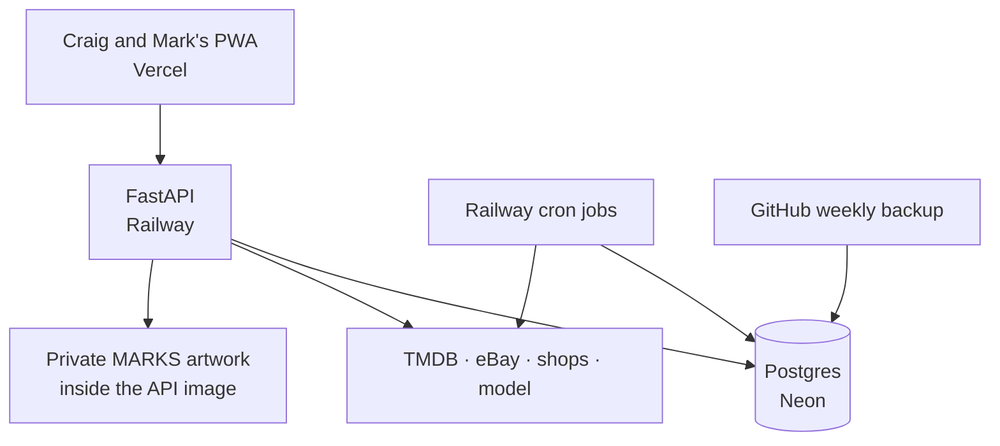
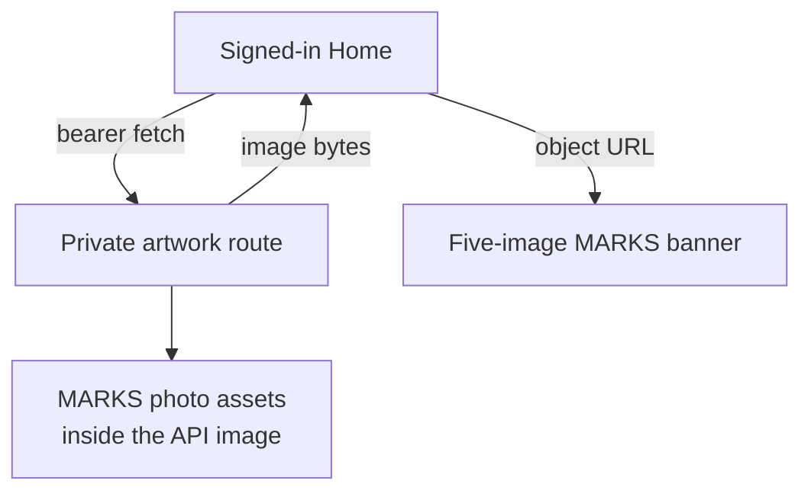
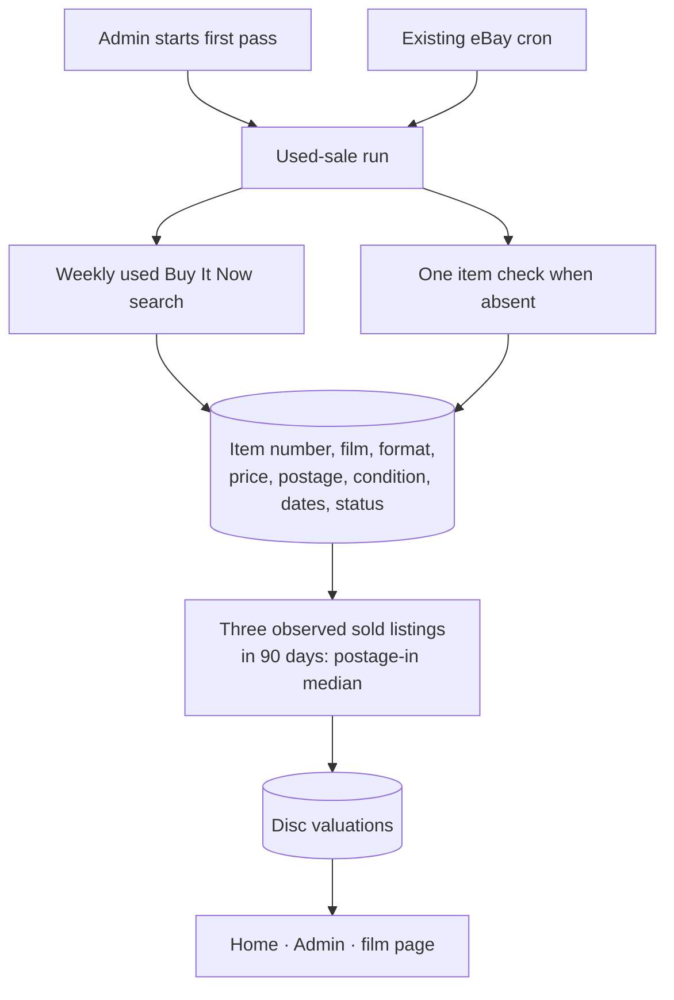

# MCU App architecture map

`STATUS.md` says which commit is deployed. This map shows the running structure through AA8,
deployed on 23 Oct; the April design intent remains in `ARCHITECTURE.md`.

## AA8, shipped 23 Oct

The original screen-print emblem remains a public, non-photo app asset and replaces the larger
in-app vector marks. The photo collages moved from Vercel's public directory into the Railway
image: an unauthenticated route request receives 401, and Home keeps the returned bytes only in
an in-memory browser object URL. The favicon and notification badge keep their 16 px vector mark.

## AA10a, shipped; first live pass read back 22 Oct

The store keeps no eBay title or image. A positive sold count on an out-of-stock listing
marks that listing sold; the figure uses its last advertised price, which can exceed an
accepted Best Offer. The run stops at 600 eBay calls per UTC day. Craig started the first
Admin pass on 22 Oct; the cron path now carries the remaining film-format pairs into later
daily budgets. AA10b is next.
