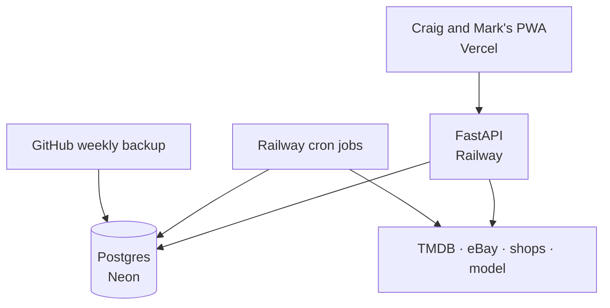
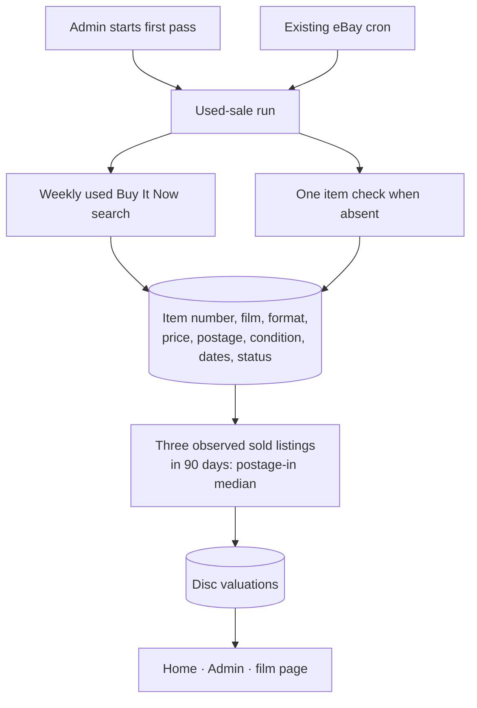

# MCU App architecture map

`STATUS.md` says which branch is deployed. This map shows the running structure and the
AA10a change pending merge; the April design intent remains in `ARCHITECTURE.md`.

## AA10a, pending close-out on 21 Oct

The store keeps no eBay title or image. A positive sold count on an out-of-stock listing
marks that listing sold; the figure uses its last advertised price, which can exceed an
accepted Best Offer. The run stops at 600 eBay calls per UTC day, and the cron path stays
inactive until the first Admin pass. AA10b has not started.
