# MCU App architecture map

`STATUS.md` says which commit is deployed. This map records the shipped structure through
AB2 on 29 Oct; the April design intent remains in
`ARCHITECTURE.md`.

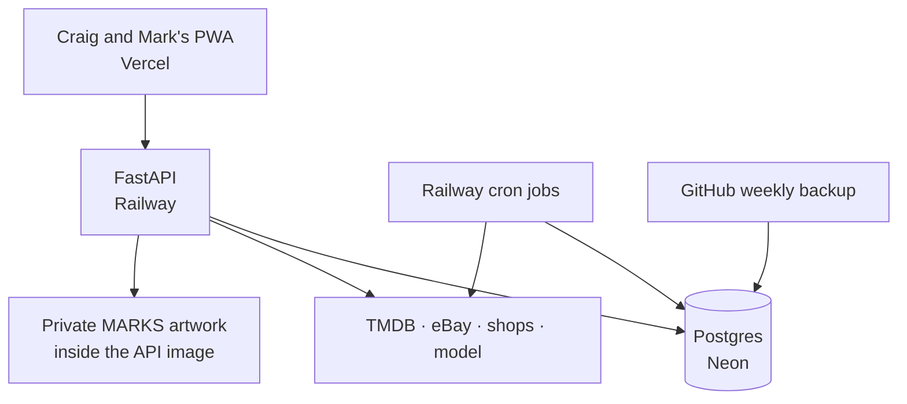

## AA8, shipped 23 Oct

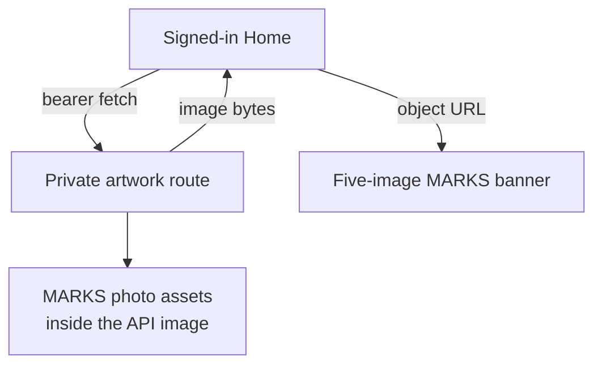

The original screen-print emblem remains a public, non-photo app asset and replaces the larger
in-app vector marks. The photo collages moved from Vercel's public directory into the Railway
image: an unauthenticated route request receives 401, and Home keeps the returned bytes only in
an in-memory browser object URL. The favicon and notification badge keep their 16 px vector mark.

## AA2, shipped 25 Oct

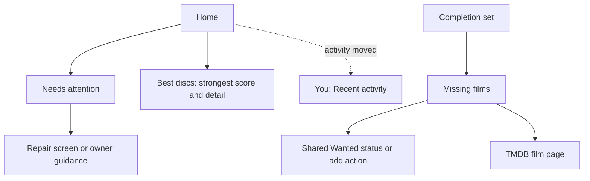

The owner-authorised refresh ran on 25 Oct: it created one current set and removed one retired
set without error. It stores an optional TMDB person portrait for a new or changed set, but the
first run exposed that unchanged rows only advance their timestamp, not their metadata: 1 of 40
sets gained a portrait. Cards therefore keep initials until a narrow metadata fix and a newly
authorised re-run. The existing completion endpoint reads each missing film's shared Wanted state,
while the screen separates missing films from those on the shelf.

## AB1, shipped 28 Oct (`ad2c992`)

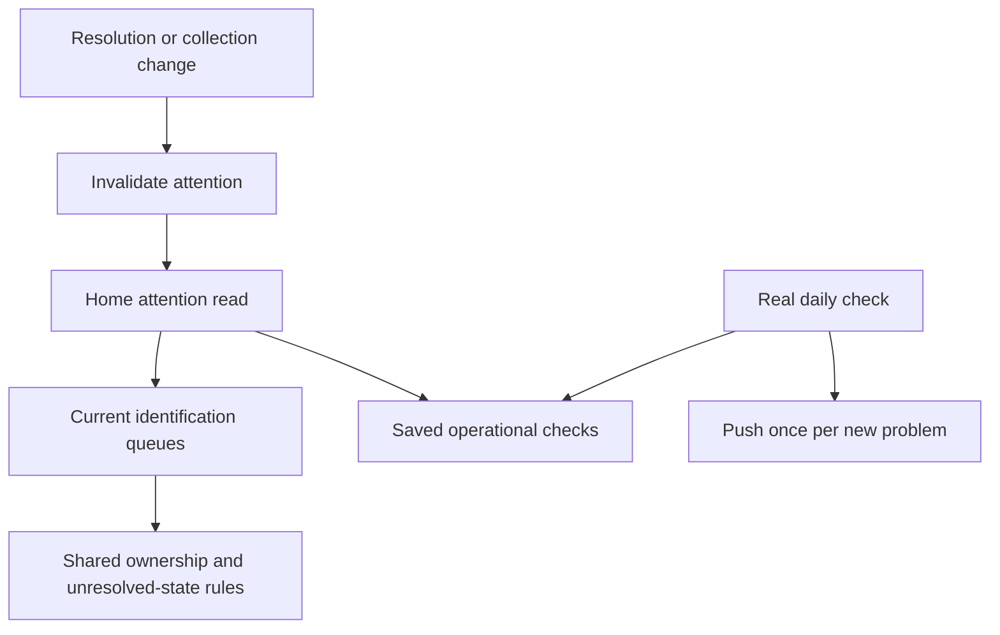

Identification warnings now reconcile the daily snapshot with the lists people can act on.
Reading Home neither writes a check nor sends a push. Historical lookup/spec/review evidence
stays intact. Settings actions select the eBay, Assistant or own-device tab; other people's
devices and Railway-only jobs receive owner guidance rather than a misleading repair link.

## AB2, shipped 29 Oct (`c187ed7`)

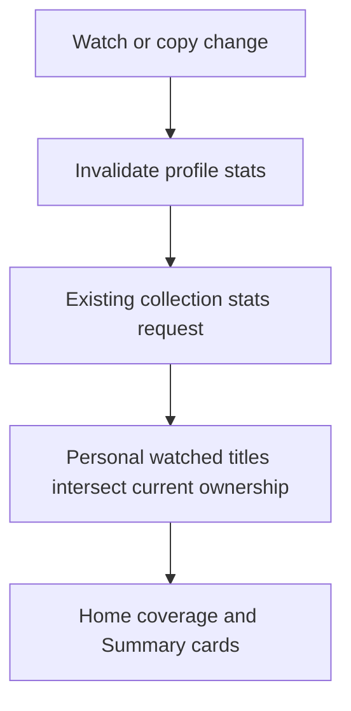

The existing endpoint adds ownedWatchedMovies; the whole-diary watchedMovies field stays
unchanged. Home shows owned coverage against totalMovies, or Unavailable for older answers.
Profile-scoped stats cache isolates each person's numerator. Visible overlapping format bars
preview the retained full breakdowns. No database shape, provider, service or history change.

## AA10a, shipped; first live pass read back 22 Oct

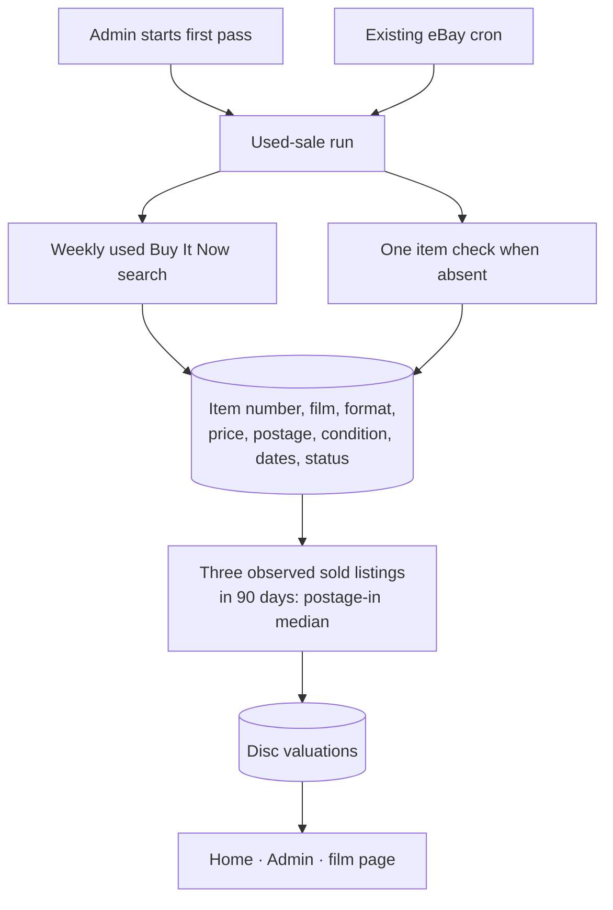

The store keeps no eBay title or image. A positive sold count on an out-of-stock listing
marks that listing sold; the figure uses its last advertised price, which can exceed an
accepted Best Offer. The run stops at 600 eBay calls per UTC day. Craig started the first
Admin pass on 22 Oct; the cron path now carries the remaining film-format pairs into later
daily budgets. AA10b is next.

## AA4, shipped 25 Oct (`6e9629d`)

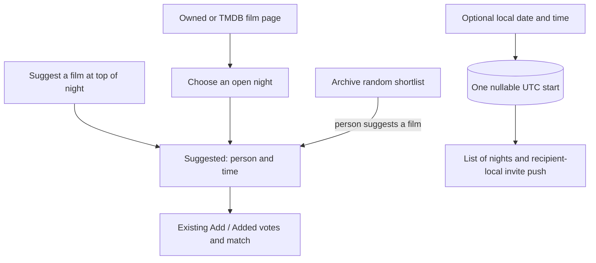

Moving a random pick to Suggested keeps its suggestion id and all existing votes. Existing
nights remain unplanned. Invite tokens remain withheld from the read-only and backup roles;
migration 066 grants only the new planned-start column.

## AA5, shipped 25 Oct (`8f47f39`)

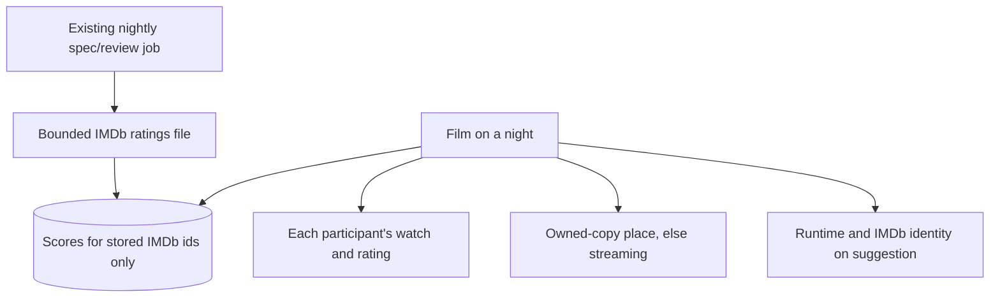

Night-only metadata stays on the existing suggestion; opening a night creates no catalogue
films or copies. IMDb cache identity and checked time prevent stale scores after an identity
correction. Failed refreshes keep previous scores and surface through the existing job check.

## AA6, shipped 25 Oct (`54dbc07`)

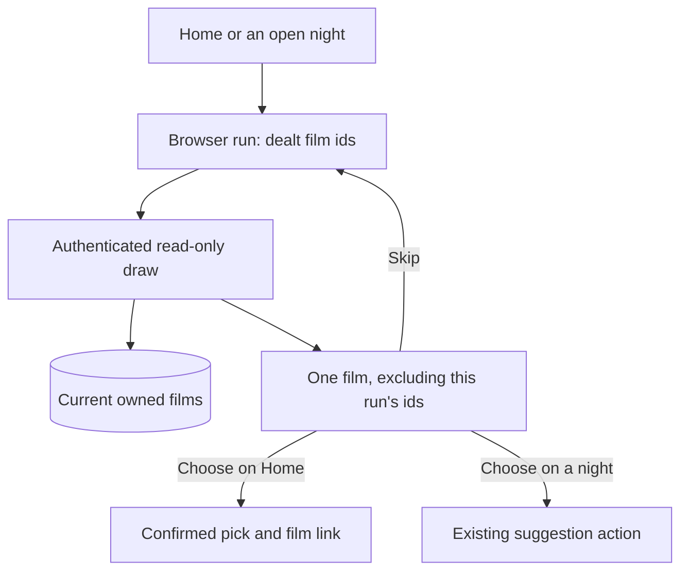

Home can deal only films unwatched by the current person. A night applies its filters;
a seeded random pick is promoted through AA4 without losing votes. A run creates no database
rows, provider calls or jobs. Existing API authentication and night membership guard the draw.

## AA7, shipped 26 Oct (`e6e5e16`)

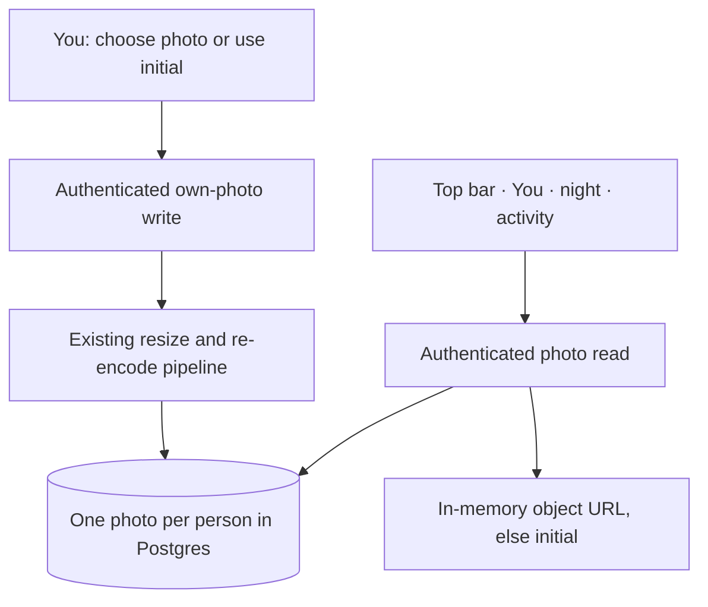

Pictures remain separate from credentials, with a 300 KiB database ceiling. Both read roles
can read the photo table but receive no new profile grants. Photo reads bypass the offline
API cache; removal returns each avatar to the initial. Activity carries the actor's stable
profile id, with a null fallback for older offline answers. No provider or new service is used.

## AA11, shipped 26 Oct (`b1075ec`)

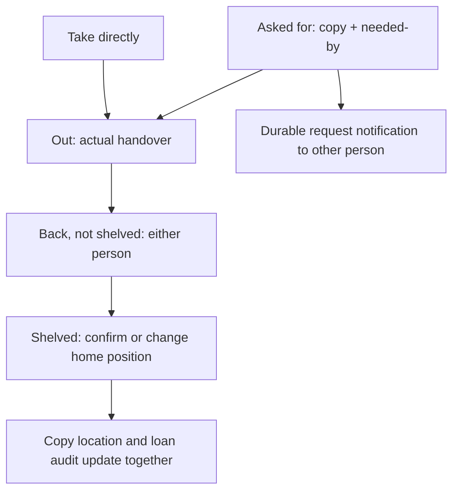

The same state and actions appear on Loans and the film's copy card. To put back lists only
current returned copies; reborrowing hides the old task without rewriting its history. Existing
NULL-state open loans read as Out, without a live backfill. Reminders apply only to Out copies.
Shelf confirmation remains available to both people, matching their existing copy-edit access;
Mark has the To put back list. No role, credential or hosting permission changes.

## AA9, shipped 28 Oct (`aecdf8d`)

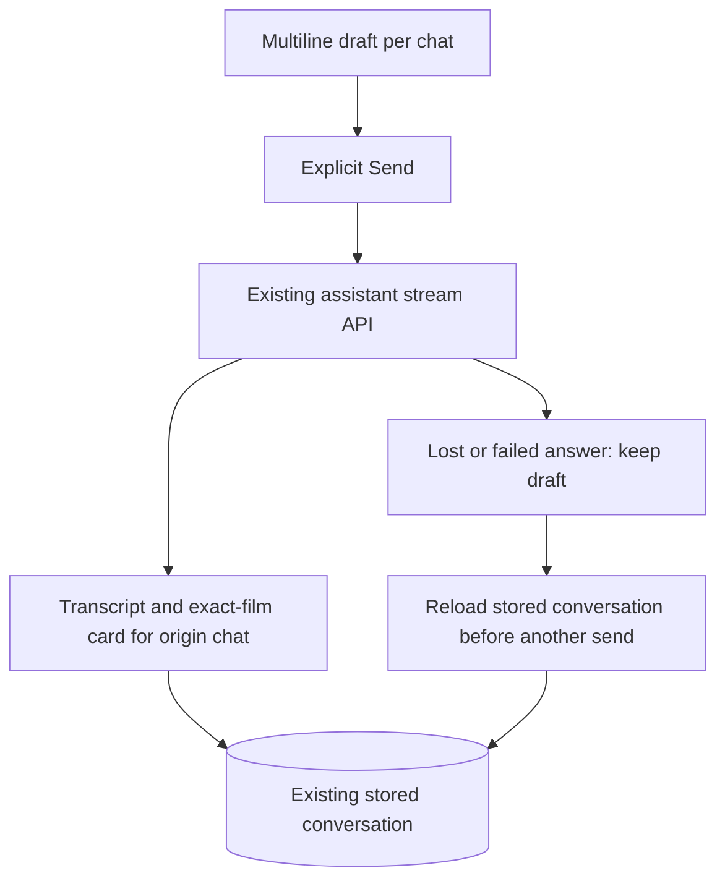

The page keeps active stream state keyed by conversation, so browser Back cannot move a reply
or card into another chat. Controls lock during a request; the request still finishes if its
page is left. A saved question is read before a different question; an unsaved draft can be
sent only explicitly after a successful reload. Existing confirmation, server roles, caps,
model, endpoints and database shapes remain unchanged. Recent chats and named deletion use
the existing private history; deleting chat never undoes confirmed diary/Wanted actions.

A deletion finishing after page navigation refreshes shared history cache but cannot reopen
the assistant. No service, database shape or provider contract was added by AA9.
