# MCU App architecture map

`STATUS.md` says which commit is deployed. This map records the shipped structure through
AB3 and the separate movie-night repair on 29 Oct, plus AB4 shipped/phone-accepted
31 Oct and the causal movie-night poster repair on 3 Nov (PR #127); the April design intent
remains in `ARCHITECTURE.md`. AB6 programme ingestion shipped3Nov(PR125/72ff0bd); AB7 discovery shipped4Nov
(PR128/bf70319 plus same-branch67d22ec and Home readiness190906ac).

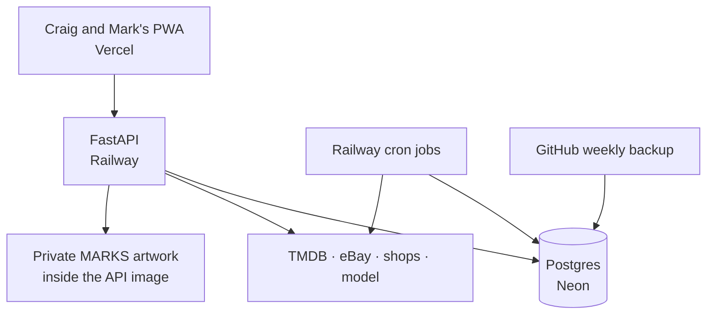

## Cinema ingestion and discovery, shipped 3–4 Nov (PR125 and PR128)

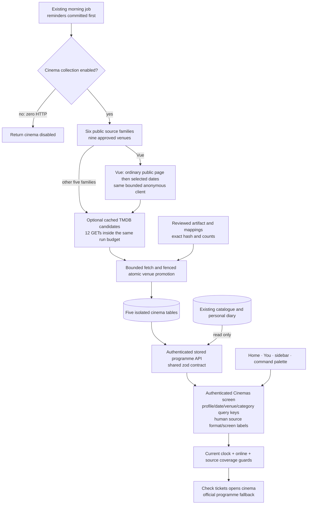

Migration071 seeds all nine disabled. The reviewed1838-row/3mapping import and enable9
completed17:13UTC after real Railway source acceptance. No source fetch happens on reads.
Observed partial dates, missing/failing coverage, upstream age and unconfirmed showings
remain explicit; stale or unconfirmed observations never expose showing booking actions.
Original year, source release date and evidenced release run are independent. Unknown
identities/categories stay unknown. The cinema child uses independent sessions/heartbeat
after reminder delivery. The #330 amendment limits Vue to today/tomorrow and adds free
TMDB metadata after source collection, with candidate review, 30-day positive/seven-day
negative cache, source fingerprints and refusal pause. The existing API-token reference
into the existing morning job was applied alone with skip-deploys after a fresh plan.
Unrelated API restart-policy drift remains unapplied.
No new service/schedule/table/browser API is added by the amendment. New run status remains
unclassified without proof. Fresh local all-nine acceptance passes63GET/all200/1843 rows; the independent Railway
pass also63GET/all200 with1838 rows after five past showings disappear. Exact fresh
loader/mappings/import/enable and both-profile API/role/credential checks pass; actual
programme1739 future at check/New0/Older1/unclassified1738. Variable horizons and unknown
years/identities remain explicit. Next scheduled run/future access is not guaranteed.
Standing #334 authorises those known stages after evidence review. The accepted 3 Nov
Vue amendment visits its known ordinary public page once before today/tomorrow date GETs,
inside the same caps; other adapters are unchanged. Cookies remain memory-only/host-scoped,
page/date failures fail Vue, failed prefixes stay excluded. Artifact protocol ab6-3 requires
fresh reviewed evidence; the earlier failed artifact is not patched into acceptance.


AB7's screen is now deployed. Home/You/sidebar/palette enter the same stored-programme
view; selection changes hide old actions, and current clock/online/source guards precede
showing ticket links. The source payload stays raw while known projection enum/screen
labels become human text. No source request, catalogue/diary mutation or new provider runs
in the screen. Verified global IDs group; uncertain source identities stay separate.
Current4–17Nov programme has1,617 future showings, all run-unclassified; partial dates and
unknown years stay visible. Strict New/Older filters may be empty. Next08:00UTC source
refresh/future access is unproved; source fees0/existing resources unpriced. Final exact
main/production stamp is in PR128; no next sitting is authorised by this completion.

Home's integration guard (4 Nov follow-up) observes the same cached stats/value/admin
attention reads as the upper rows. While those initial reads are loading, native Home
pick controls and the cinema entry cannot accept a tap; enabling follows the committed
layout. It adds no source request, timer, data write or Home reorder. The held-response
regression preserves the original native checkbox assertion and verifies one stats GET.

## At the cinema, film first — AC4

AB7's filter-first Cinemas page became Movie night's second view (#341). One read of the
stored fortnight feeds the view, its filters and Home's strip; a second read gives one film's
every showing. Both draw a showing through AB7's own coverage and ticket rule (`Window.showing`),
so nothing about tickets changed. `/cinemas` redirects to the view.

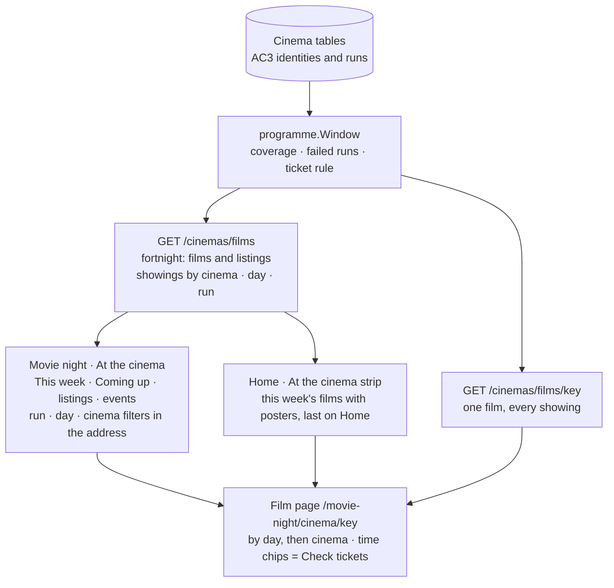

A film is one TMDB film across cinemas and listing titles (AC3). A row that is not becomes its
own chain's listing, gathered within that source by AC3's review key and never merged across
chains or into a film on the title alone (#342). A listing's address (`listing-<row id>`) opens
the film once a morning links it; a film's is `tmdb-<id>`. Since AC5 a trip is proposed from a
film page's times (below).

## Cinema trips — AC5

A trip is two tables (#345, #346): the proposer and the chosen showing kept as a snapshot, and
one reply per invitee. Every write locks the trip's row and names the revision it was made
against, so replies at once all land and one made against an old time is refused. The flag and
Check tickets come from the live programme row on each read. Pushes go through the outbox under
the Movie night switch, deduplicated by revision; the morning-of reminder rides the 08:00 pass.

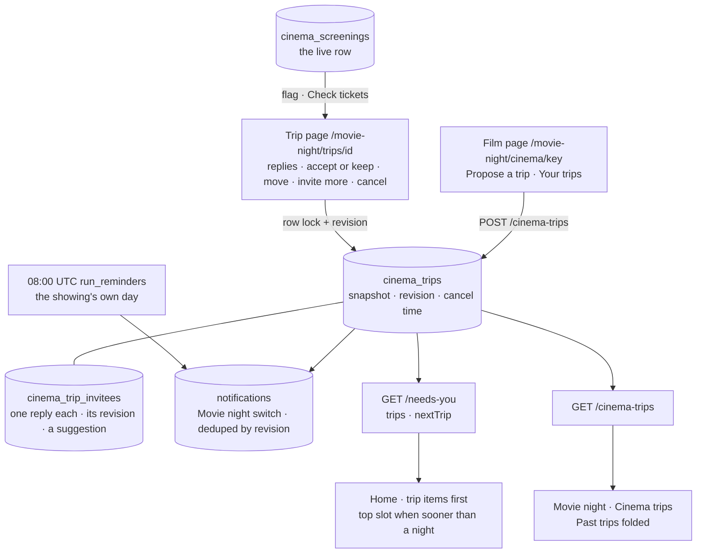

Who sees a trip: its proposer and invitees only; anyone else reads "Trip not found". Nothing
assumes two people. No guests, and no reply link that works without sign-in (#335).

## Daily cinema digest — AC6 (deployed 7 Nov, PR #136, `46aaba5`; acceptance open)

Approved in #348. Migration 073 keeps identity/listing/appearance history independently of
programme retention, one evaluated London day and one committed delivery claim per person/day.
Preference changes and claims share the profile row lock; an off switch cancels pending rows,
and a narrower filter permanently excludes pending titles. No source is fetched by a read.

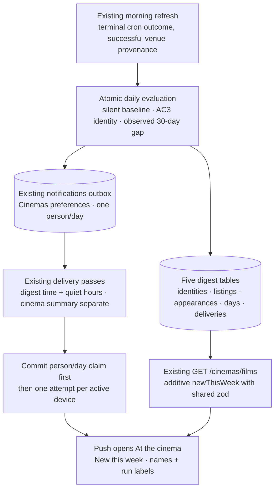

Failed venues add no appearances; failed/unfinished runs add no daily result. The first usable
daily result freezes retries. A committed claim survives a crash, so uncertain transport is
never replayed; that can lose a push. Partial successful sources count as observed absence,
not proved complete absence. Held delivery may wait until the following day. No schedule,
provider, hosting or credential change. AC5's Movie night category and reminder order stay.
Production migration 073, both roles' grants, credential exclusions and the silent baseline
(278 listings, 23 identities) were read back at 16:46 UTC. No appearances, evaluated days,
delivery claims or cinema outbox exist yet. Scheduled production evidence and real-phone
receipt/tap remain pending; no manual digest or refresh was triggered.

## Releases, two calendars — AC7

Releases split into Disc releases and Cinema releases, each its own address and month (#343).
Each month asks the month endpoint for its own release types and keeps only those on the device
too. The cinema month joins AC4's fortnight read by TMDB id, so a release showing at one of the
nine opens its film page; a title alone never links. One subscribe press gives a feed per
calendar and one for both, on the one token a person has (#344).

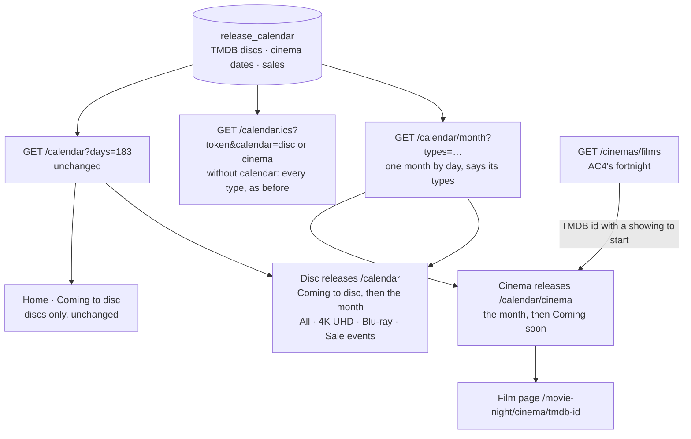

### Calendar control readiness — deployed 7 Nov (#350, PR #137, `7c536d9`)

The page and its sections observe the same month/window/cinema query options and cache.
Get my calendar links uses native disabled/busy semantics while the relevant layout queries
are pending/fetching. Terminal errors and paused offline reads settle; reconnect/refetch
holds the control again. Coming soon uses loading/offline/error/empty states honestly.
The three feed links and single-token rotation stay on the existing endpoint; no extra GET.

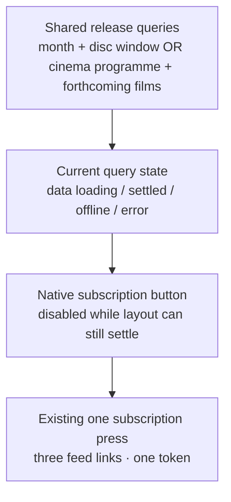

## AA8, shipped 23 Oct

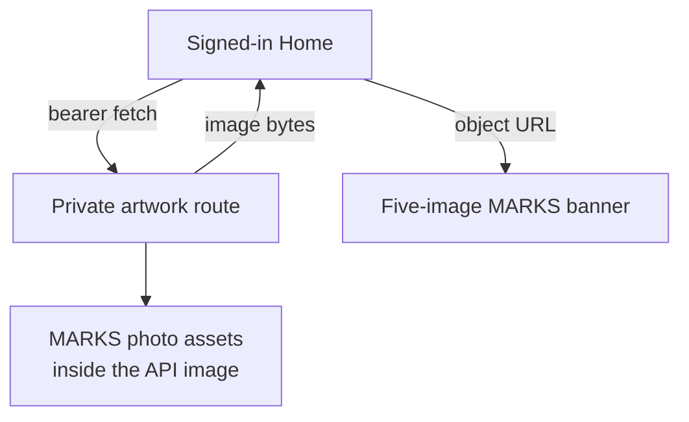

The original screen-print emblem remains a public, non-photo app asset and replaces the larger
in-app vector marks. The photo collages moved from Vercel's public directory into the Railway
image: an unauthenticated route request receives 401, and Home keeps the returned bytes only in
an in-memory browser object URL. The favicon and notification badge keep their 16 px vector mark.

## AA2, shipped 25 Oct

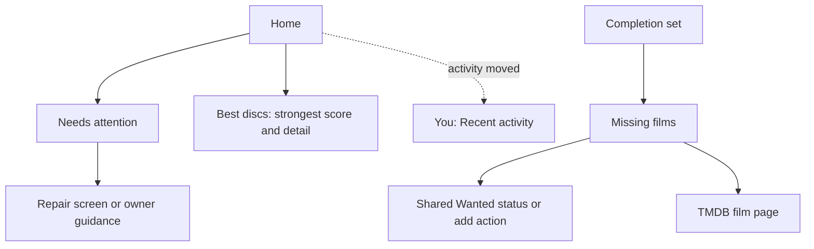

The owner-authorised refresh ran on 25 Oct: it created one current set and removed one retired
set without error. It stores an optional TMDB person portrait for a new or changed set, but the
first run exposed that unchanged rows only advance their timestamp, not their metadata: 1 of 40
sets gained a portrait. Cards therefore keep initials until a narrow metadata fix and a newly
authorised re-run. The existing completion endpoint reads each missing film's shared Wanted state,
while the screen separates missing films from those on the shelf.

## AB1, shipped 28 Oct (`ad2c992`)

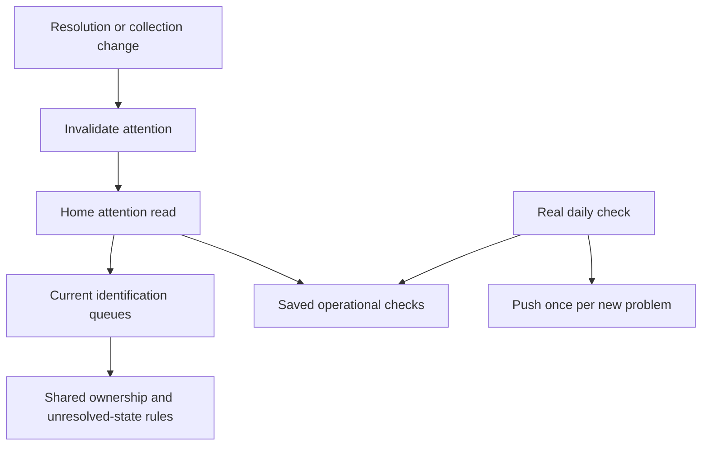

Identification warnings now reconcile the daily snapshot with the lists people can act on.
Reading Home neither writes a check nor sends a push. Historical lookup/spec/review evidence
stays intact. Settings actions select the eBay, Assistant or own-device tab; other people's
devices and Railway-only jobs receive owner guidance rather than a misleading repair link.

## AB2, shipped 29 Oct (`c187ed7`)

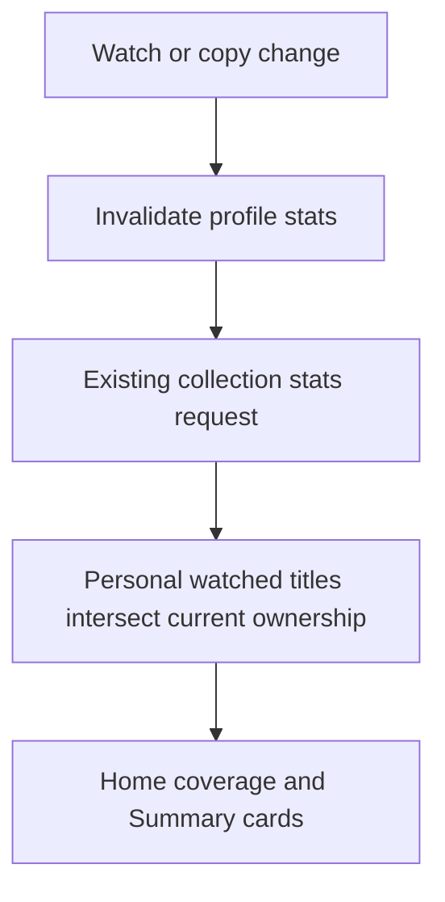

The existing endpoint adds ownedWatchedMovies; the whole-diary watchedMovies field stays
unchanged. Home shows owned coverage against totalMovies, or Unavailable for older answers.
Profile-scoped stats cache isolates each person's numerator. Visible overlapping format bars
preview the retained full breakdowns. No database shape, provider, service or history change.

## AA10a, shipped; first live pass read back 22 Oct

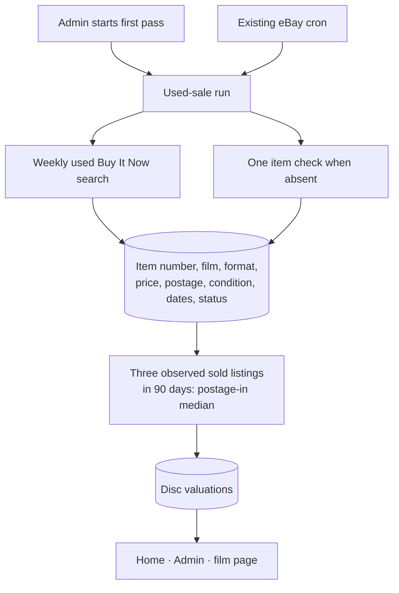

The store keeps no eBay title or image. A positive sold count on an out-of-stock listing
marks that listing sold; the figure uses its last advertised price, which can exceed an
accepted Best Offer. The run stops at 600 eBay calls per UTC day. Craig started the first
Admin pass on 22 Oct; the cron path now carries the remaining film-format pairs into later
daily budgets. AA10b is next.


## AA4, shipped 25 Oct (`6e9629d`)

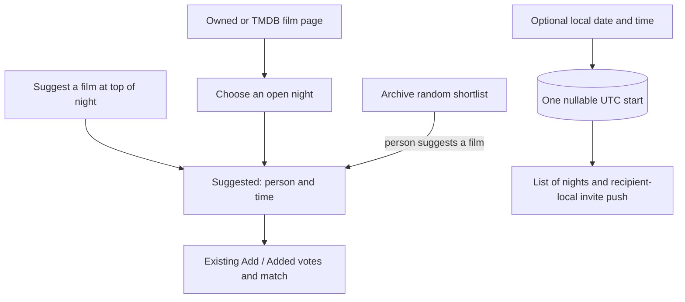

Moving a random pick to Suggested keeps its suggestion id and all existing votes. Existing
nights remain unplanned. Invite tokens remain withheld from the read-only and backup roles;
migration 066 grants only the new planned-start column.


## AA5, shipped 25 Oct (`8f47f39`)

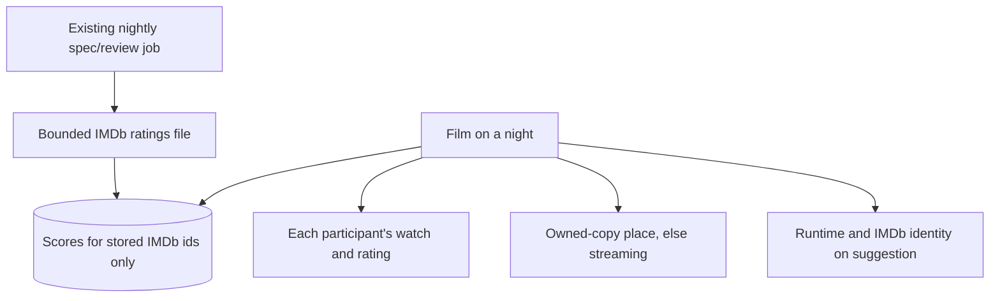

Night-only metadata stays on the existing suggestion; opening a night creates no catalogue
films or copies. IMDb cache identity and checked time prevent stale scores after an identity
correction. Failed refreshes keep previous scores and surface through the existing job check.

## AA6, shipped 25 Oct (`54dbc07`)

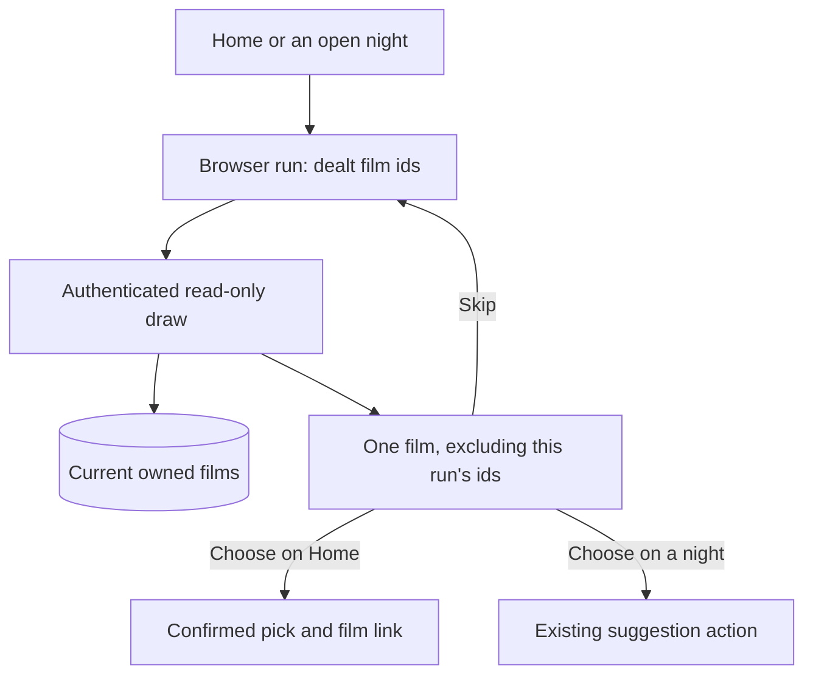

Home can deal only films unwatched by the current person. A night applies its filters;
a seeded random pick is promoted through AA4 without losing votes. A run creates no database
rows, provider calls or jobs. Existing API authentication and night membership guard the draw.

## AA7, shipped 26 Oct (`e6e5e16`)

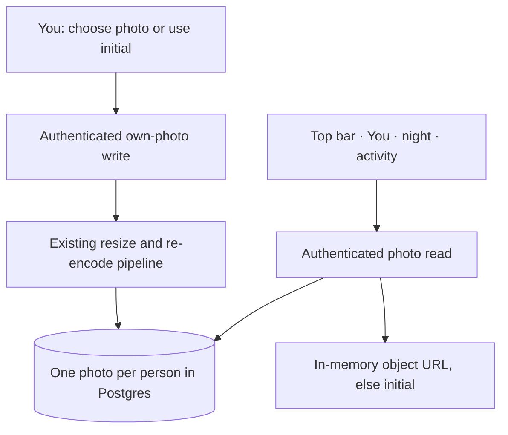

Pictures remain separate from credentials, with a 300 KiB database ceiling. Both read roles
can read the photo table but receive no new profile grants. Photo reads bypass the offline
API cache; removal returns each avatar to the initial. Activity carries the actor's stable
profile id, with a null fallback for older offline answers. No provider or new service is used.

## AA11, shipped 26 Oct (`b1075ec`)

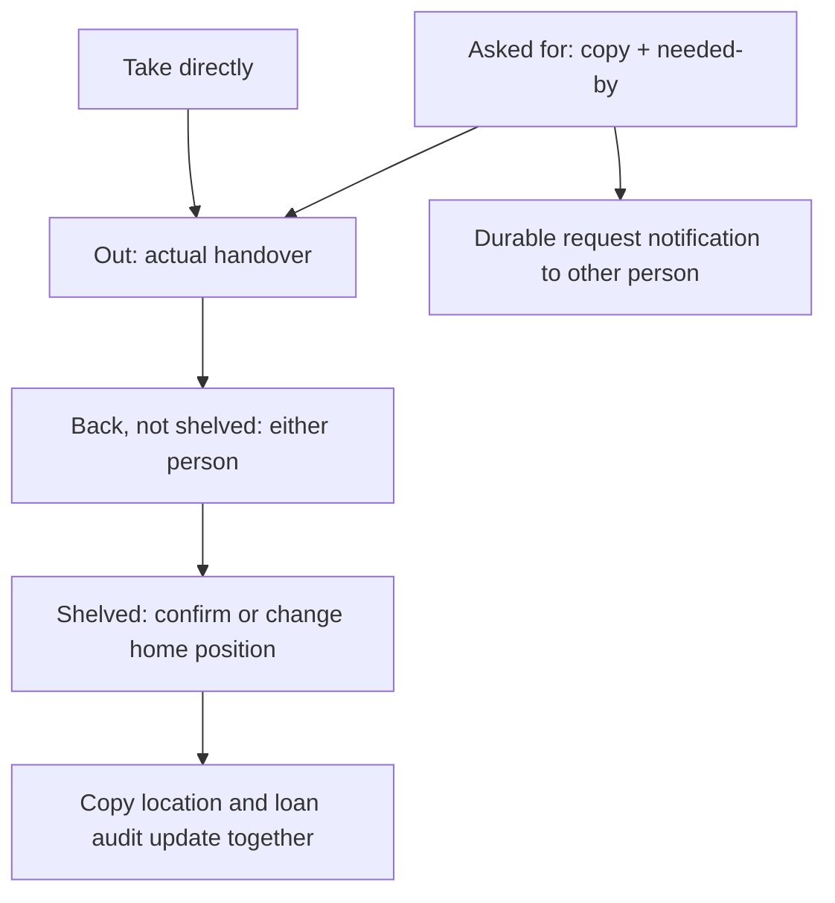

The same state and actions appear on Loans and the film's copy card. To put back lists only
current returned copies; reborrowing hides the old task without rewriting its history. Existing
NULL-state open loans read as Out, without a live backfill. Reminders apply only to Out copies.
Shelf confirmation remains available to both people, matching their existing copy-edit access;
Mark has the To put back list. No role, credential or hosting permission changes.


## AA9, shipped 28 Oct (`aecdf8d`)

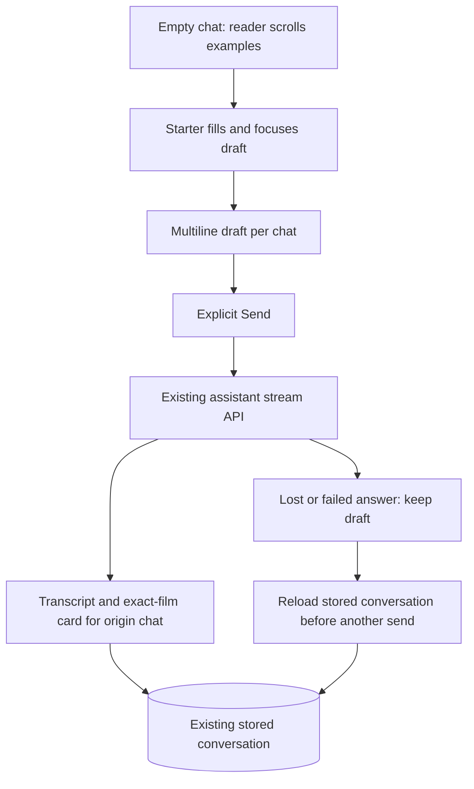

The page keeps active stream state keyed by conversation, so browser Back cannot move a reply
or card into another chat. Controls lock during a request; the request still finishes if its
page is left. A saved question is read before a different question; an unsaved draft can be
sent only explicitly after a successful reload. Existing confirmation, server roles, caps,
model, endpoints and database shapes remain unchanged. Recent chats and named deletion use
the existing private history; deleting chat never undoes confirmed diary/Wanted actions.

A deletion finishing after page navigation refreshes shared history cache but cannot reopen
the assistant. No service, database shape or provider contract was added by AA9.

The 2 Nov starter repair (`7b67375`, PR #126, #331) limits automatic following and Latest answer to transcripts
with messages. Scrolling the empty examples cannot insert a control that shrinks their
visible area mid-click. Availability updates leave that landing's scroll position alone.


## First movie-night seeding, repaired 29 Oct (`bf0eb36`)

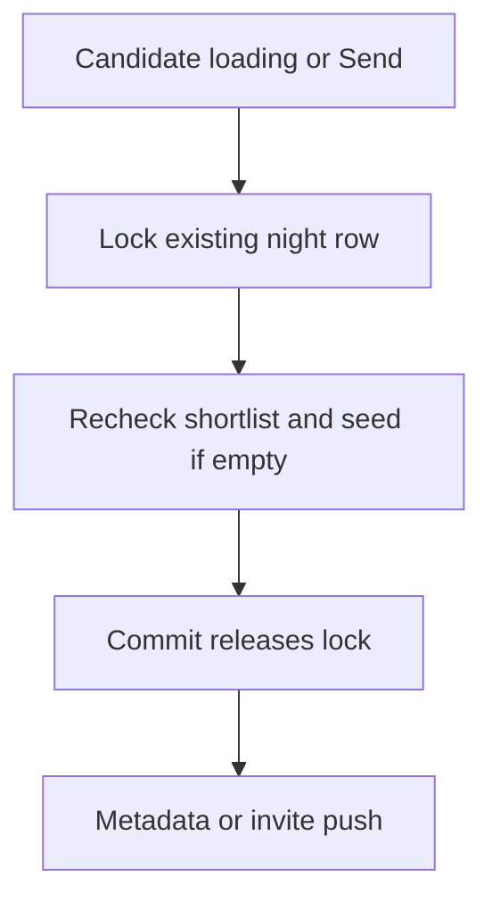

The lock is per night and works across API workers. A waiting caller reads the committed
shortlist, or seeds after rollback. Existing vote lock ordering is retained. No new database
shape, service, provider or API contract. Real-phone push/match acceptance remains Craig's.

## AB3, shipped 29 Oct (`5cfa467`), after owner approval (#306)

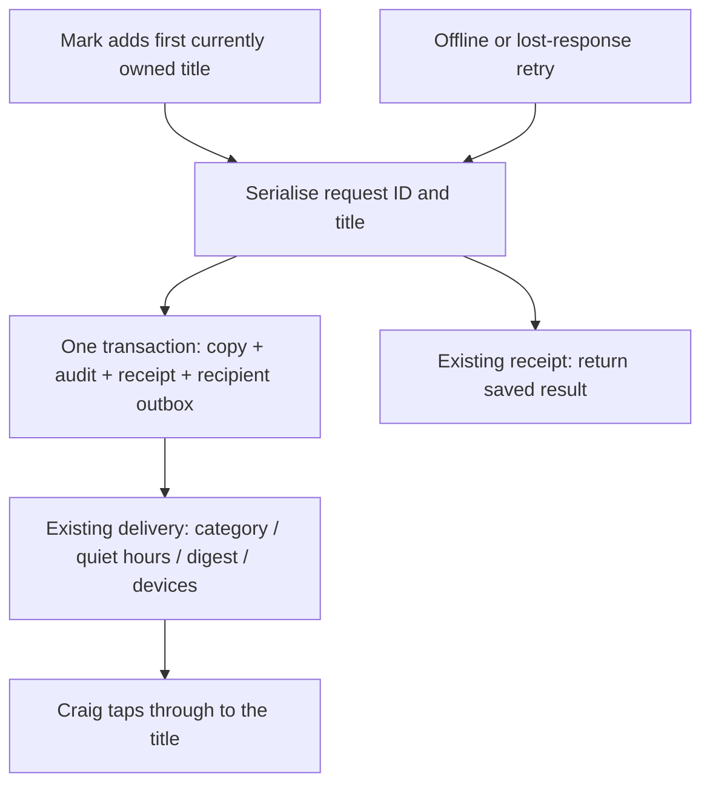

Mark's verified profile UUID selects the sender; roles and display names do not. New
film/series/manual titles and reacquisition through Add qualify; editions and restores do
not. Optional clientRequestId and durable receipts preserve the successful response through
replay, including after a copy is removed. Existing offline readback remains the first check.
Each other active profile gets one event, default on. Delivery claims queued rows under a
lock so concurrent API/cron passes cannot send the same row concurrently. Transport runs
after the add commits and cannot roll it back. Migration 070 adds the preference, receipts
and category vocabulary; existing collection and watch-history rows are not rewritten.
Real-phone receipt remains owner acceptance after shipment.


## AB4, shipped and production iPhone accepted 31 Oct (PR #122, df6824a)

```mermaid
flowchart TD
    Apple[Apple Home Screen signal before React mounts] --> Gate[Phone layout and non-zero top safe area]
    Gate --> Gap[Shared 32px clearance below safe area]
    Gap --> Header[Phone header controls]
    Gap --> Search[Search sheet controls]
```

Browser tabs, Android installations, desktop layout and zero-top-inset orientation get
zero extra clearance. The header remains relative in the existing flex shell; its main
scroll area gives up 32px where the rule applies. Both themes use their existing solid
surface. No status metadata, navigation, login-return, deep-link or normal-resume rule
changes. The affected iPhone confirms both the installed actual-app sample and original
production MCU sharp for Archive/Search in both themes, with normal keyboard. Native
production acceptance is complete; simulated browser geometry is separate evidence. Original
Archive cold launch resolved through the approved re-add (#309/#310); normal resume
preserves Home, no navigation code change. Old bundle/internal launcher target uninspected.

## Assigned identity reviews — AD1, deployed 9 Nov (PR 138; phone acceptance open)

```mermaid
flowchart TD
    A[Craig checks current targets] --> B[Assign three private reviews]
    B --> C[Mark: Home Needs you / You]
    C --> D[Record observation + audit]
    D --> E[Craig inspects pending correction]
    F[Existing catalogue actions] --> G[Recheck target on every read]
    G --> C
```

`assigned_reviews` stores assignment, relevant target snapshot, revision and current answer;
`admin_actions` retains assignment/answer/reassignment history. Target IDs deliberately do
not constrain catalogue deletion/merge paths; missing, sold or changed targets block new
answers rather than silently resolving. Existing doubt resolution or Shetland TV 46923
identity is recognised from source records. A changed wanted identity remains for review
because it is not proof of retained price-history correction. Existing loans/trips stay
derived, permissions stay scoped, Home reads perform no source request and assignments
send no notification. API `reviews` is additive with a shared zod default; `/needs-you`
shows every review/history. Deployed at b3e7966: 074/grants, exact three assignments and
audits verified; Mark's real answers/phone acceptance remain open. Final CI/parity stamp
is recorded in PR 138. No notification or automatic catalogue correction.

Film-page navigation follow-up (8 Nov, decision 352): movie-night reads fill a reserved
44 px action row above the film tabs and Owned copies controls. A delayed response no
longer inserts height while Add a copy is being pressed. The multiple-night selector
stays on that row; suggestion writes and navigation use the existing paths. This deployed
repair adds no data shape, service, permission or external contract.

## AE1, shipped 9 Nov (PR 139, `aa4242e`) — one box or a separate copy

```mermaid
flowchart TD
    A[Edit copy: tick a second disc] --> B{Save asks}
    B -->|One box| C[PUT the combo, as before]
    B -->|A separate copy| D[Nothing saved]
    D --> E[Add a copy: film and format from the address]
    F[Film page: Add a copy] --> E
    E --> G[Duplicate check per format]
    G --> H[POST a second copy]
```

Web only: no API, schema or stored-copy change. `lib/copy-formats.ts` holds the rules (disc
formats, what an edit adds, the address of Add a copy). The add page reads `movie` and `format`
from its address, keeps its finder under the chosen film, and runs its duplicate check as a
query on film, formats and barcode.

## AE2, shipped 10 Nov (PR 140, `f0827ff`) — Recently added on Home

```mermaid
flowchart TD
    A[GET /highlights] --> B[recentlyAdded: newest owned copy per film, added in the app]
    A --> C[mostValuable, mostRewatched, bestReviewed]
    B --> D[Home line-up: no film twice]
    C --> D
    D --> E[Highlights tabs: Recently added first]
```

`_recently_added` ranks owned copies with an `added_at_utc` per film (row_number) and keeps the
newest twelve films, naming the adder through `added_by` (SET NULL safe). The field is additive,
zod-defaulted in `packages/shared`, and in the OpenAPI snapshot. Web only otherwise: the featured
card's layout and the estimate panel's place moved; no data shape changed.

## AE3, shipped 10 Nov (PR 141, `1b19579`) — films that do not count

```mermaid
flowchart TD
    A[completion_sets: members by TMDB id] --> C[GET /insights/completion]
    B[completion_exclusions: set, film, who] --> C
    D[movies owned] --> C
    C --> E[Counts leave out films that do not count]
    C --> F[missingFilms: first three that count]
    G[POST and DELETE .../exclusions] --> B
    G --> H[admin_actions: create / delete]
```

New table `completion_exclusions` (migration 075), read with the completion sets in one query
per page. The read's additions (`excludedCount`, `missingFilms`, `counts`) are zod-defaulted. Home's
row and the set page call the two new routes; both people see the same.

## AE4, shipped 10 Nov (PR 142, `ae36c41`) — two budgets and a cinema awaiting its first enable

```mermaid
flowchart TD
    A[08:00 morning run] --> B[Due: switched-on cinemas, and an awaiting one beside them on its source]
    B --> C[Cinema sites: 120 requests]
    C --> D[Showings and coverage]
    D --> E[TMDB lookups: their own 120]
    D --> F{Switched on?}
    F -->|No, awaiting| G[In no view or digest]
    F -->|Yes| H[At the cinema, film pages, digest]
    I[refresh_cinemas --enable: fresh coverage, audited] --> F
```

`fetch.py` keeps the two caps (`SITE_CAP`, `METADATA_CAP`); `refresh.due_venues` adds the awaiting
cinemas from `awaiting.py`; `programme.load_window` and the digest's evaluation leave them out
until enabled. Migration 076 adds the Omniplex's venue row, switched off; its downgrade refuses
once anything refers to it.

