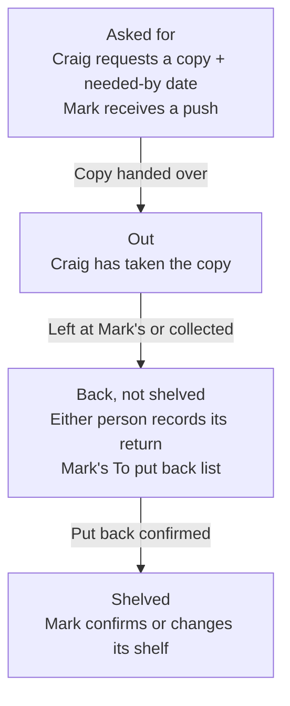

# AA11 — Loan story for Craig's sign-off, 26 Oct 2026

## Decision pending — no implementation

AA7 is shipped. This is the next owner checkpoint in Group AA sitting 4.
Only this story is prepared; no AA11 API, migration, notification or screen has been built.
Sitting 5 remains excluded.

## The story

Craig can also take a disc without first asking: recording that starts directly at Out.
The journey belongs to a particular physical copy, so its format/edition is clear when a
film has several copies. Loans and the film's copy card show the current state. The shelf
stays recorded as its home position while it is away; Back, not shelved stays visible until
putting it back confirms that shelf or records the new one. A request/needed-by date does
not prove a handover happened. No date or background job advances a state automatically.

Needed by means when Craig wants to receive it. The existing optional due date still means
when it should be returned. They remain separate dates. Either person can record the return,
whether Craig has left it at Mark's or Mark has collected it. Mark's list is the practical
place to finish putting copies back. Existing support for both people lending/borrowing,
and lending to a named friend, remains.

## Current facts and proposed handling

The live database was read in a read-only transaction on 26 Oct: **four loans, all four out,
zero returned**. They keep their borrower, actual lent date, optional due date and copy
location; the new nullable state reads as Out for those existing open loans. No live loan
record or shelf is rewritten as part of this proposal.

The current schema requires a lent date and uses returnedDate alone to decide open/closed.
A request has no actual lent date yet. The proposed migration therefore also permits a null
lent date until handover, alongside the ledger's nullable state, needed-by, returned-by and
shelved-at additions. The shared API response must accept that null date, and loan reminders
must apply to copies that are actually Out. This avoids inventing a lending date for a request.
Migration/grant and compatibility checks are required; no hosting or credential change is needed.

Automatically treating a return as shelving was rejected because it recreates the current
fault: a disc left on Mark's table appears to be back on its shelf.

## What approval would authorise

Build only AA11's four-state loan flow, the request push to Mark, the To put back list,
copy-state display and shelf confirmation/update, with the compatible migration and full
API/shared/web/browser/job verification. Preserve the four existing open loans. Changes to
real loan/shelf data still happen through the person's app actions, not an agent-run backfill.

Cost: one migration, loan API/UI and reminder changes, plus the full local and seven-job CI
gate before shipment. This story does not authorise a live test notification or fabricated
production loan. No work on sitting 5 is authorised.

## Acceptance criteria, verbatim

### AA11 — Lend and borrow as it happens 🟡
- **25.** A loan runs **asked for → out → back, not shelved → shelved**. Craig asks in the app
  for a film with a needed-by date (Mark gets a push; Craig's word, 21 Oct), or records taking it
  himself. Either person
  marks it back (left at Mark's, or collected). Mark gets a "to put back" list, and putting one
  back confirms or changes its shelf. Loans and the film page say which state a copy is in.
- The story is shown to Craig as a short flow first and signed off before building. Migration
  (state, needed-by, returned-by, shelved-at, all nullable) granted as above.
- Tests (the e2e loans case extended). Gate green.
