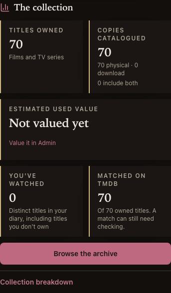
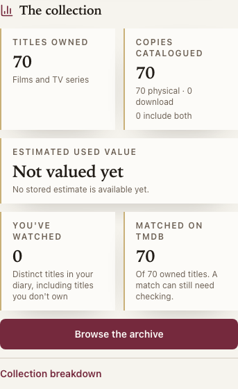

# AA3 — collection summary verification

27 Oct · local verification complete; PR/main CI and shipment pending.

Craig approved Compact summary, corrections, both personal/match numbers retained with
clearer definitions, and the two additive stats fields before implementation (#299).
The build plan and owner-picked preview are the acceptance source.

## Behaviour under test

Five metrics stay readable without sideways navigation. Physical copies and copies also
carrying downloads are direct counts from one aggregate query; multiple physical formats
never count a copy twice. Existing stats fields retain their meanings. Missing new fields
on an older API stay unavailable rather than becoming zero or being inferred from value.
The other Home shelves remain sideways. Charts expand in place; place names wrap and
monthly recorded spending can be read without hover. Both people retain their whole-diary
watch count and identified-owned-title count, with their limits written beside them.

## Failures and repairs

- Initial web lint found two unused variables in the new old-API test fixture. Removed
  the unused bindings; no lint exception was added.
- Initial web unit run: 704 passed, one failed. The existing Archive-link assertion caught
  a real regression: moving the link into the stats-loaded body hid it during loading and
  failure. The link is now outside the async body, available in every state. The existing
  assertion is unchanged.
- Review caught two additional edge cases before the final gate: missing offline value
  must say unavailable rather than loading forever, and dated recorded spending must name
  the number of dated purchases rather than all copies with prices.
- The first disposable-Postgres full run passed 2,482 tests but skipped nine collection-
  replacement cases because they require a localhost TCP URL rather than a Unix socket.
  Enabled loopback-only TCP for this disposable server so the clean gate can exercise them.
  The restart caller initially waited on the daemon's inherited output pipe; interrupted
  that caller, verified the running server and updated only ignored local test URLs.
- The first Chromium run passed the mixed-format API assertion but both new UI cases
  could not locate the physical/download line exactly: it shared a DOM text container
  with the overlap line. Each line now has its own span, preserving all exact expected
  values and assertions. Focused dashboard tests passed after this markup correction.
- Before the browser run, review caught that the new fixture would change the import
  journey's pinned 70-title baseline. Its own copy is now removed through the app API in
  `finally`; the import journey's existing expected count remains unchanged.
- Image inspection caught that the Archive action was content-width rather than the
  chosen full-width action. Added explicit full width and an exact browser width assertion.
  Component captures use a taller viewport to keep the fixed navigation out of the crop;
  functional checks still run at the normal 844 px height. The passing in-progress browser
  run was stopped for this visual correction; the complete final suite is required again.
- Final copy review made the sale threshold explicit: at least three observed sales in
  90 days, using their advertised-price median. Added exact unit assertions for the
  threshold/window and the Best Offer limitation; no price algorithm or stored value changes.

The only changed existing layout expectation is Craig's approved collection-only exception
to the “every Home section is sideways” rule; every other shelf assertion stays. API route
inventory and access assertions are untouched. OpenAPI snapshot changes only the two
approved fields and their required-field entries; its exact comparison stays.

## Earlier verification checkpoints

Focused API/stat/OpenAPI checks passed: 22 tests on disposable Postgres.
All ten standard local checks passed from clean commit `c164226`: API 2,491 passed with
zero skips; shared 157 and web 708 passed; lint/typechecks/builds passed. All 16 derived-field
trigger cases ran. A subsequent E2E-only fixture-cleanup commit changed no tested app source.
The final markup correction receives a fresh clean gate and browser run before close-out.
The second clean gate also passed all ten checks on `c1be577` (API 2,491, shared 157,
web 708, no API skips). Both new AA3 cases then passed in Chromium and Firefox; the final
full-width action correction receives another clean verification before shipment.
Browser screenshots, seven-job PR/main CI and exact production SHA/readiness proof remain
pending. Local WebKit is unavailable on macOS 13; CI must run it.
Real-phone observations remain owner-only. No live provider call, valuation start, data write
or synthetic production account/session is authorised or performed.

## Final local evidence — clean commit `b837148`

All ten `batch-verify.md` commands passed from a clean tree, and it remained clean:
API **2,491 passed, zero skips**; shared **157 passed**; web **708 passed**; Python/web
lint, formatting, mypy, both typechecks and both builds passed. Web lint retains 11 existing
Fast Refresh warnings; no new exception, ignore or disabled check. The E2E typecheck passed.

The complete available local E2E suite then passed against disposable loopback-only
Postgres with the outside world faked: **Chromium 41 passed; Firefox 40 passed and one
documented dictation skip; cron jobs six passed**. WebKit is CI-only on this Mac.
No browser retry or new skip was added. Initial interrupted runs and their failure artefacts
are retained under the ignored AA3 scratchpad; the final run completed normally.

The final copy-only correction was then verified from clean commit `8a3e844`: all ten
commands passed again with the same 2,491 / 157 / 708 test counts and zero API skips.
The full local E2E run above covers the unchanged layout and flows; the clarified value
explainer has exact unit assertions. The PR's final exact-head seven-job CI is still required.
GitHub's connector returned integration-write 403; the already-authenticated `gh` CLI
created PR #115 without changing a credential or permission.

| Acceptance | Evidence | Result |
|---|---|---|
| Five metrics without sideways navigation | Both people, both themes, 375 px/desktop, 320 px overflow checks; exact Archive action width | Local pass |
| Accurate physical/download overlap | API fixtures: physical-only, download-only, mixed combo, sold/trash, listed-for-sale, empty; both roles | Pass |
| Retain diary and identification meaning | Exact personal/match values and explanatory text in unit/browser assertions | Pass |
| Honest value and purchase-price coverage | No-value, loading, offline, failed value/refresh, partial/sales coverage and tap-readable month figures | Pass |
| Existing breakdowns stay reachable | Native disclosure opens formats, places, genres and decades; spending keeps its data/empty explanation | Pass |
| Other Home shelves and access boundaries | Existing order/sideways assertions retained except the owner-approved collection exception; route inventory unchanged | Pass |
| Full CI and production exact SHA/readiness | Required before close-out | Pending |

## Read-only production evidence

The current stats router was called against production using a connection whose every
transaction is read-only. Both new response counts agreed with independent SELECTs and
valuation's existing copy eligibility: 1,472 physical copies, 589 download copies, 134 in
both, 1,927 total catalogue copies. Both people own the same 1,903 titles; their existing
diary values remain Craig 500 and Mark 879, and matched titles 1,902.
Stored value was £15,939.38 across 1,311 of 1,472 physical copies, zero sales-backed.
This remains an interim observation, **not AA10b's final after-total checkpoint**.

The new four-count aggregate was also explained on production under a read-only transaction:
first observation 370.6 ms execution / 69.7 ms planning; a warm repeat 4.8 ms / 1.3 ms.
These are database timings, not whole-request latency. No server cache or extra API request
was added. The valuation GET was avoided because it may abandon a stale job as housekeeping.

## Screens inspected

Actual built-app component captures, using the disposable E2E catalogue (70 titles), not
production or a physical phone. Functional tests use an 844 px viewport; the captures use
a taller viewport so the fixed navigation does not obscure the component. The full-width
Archive action and complete breakdown trigger were inspected after the visual repair.

