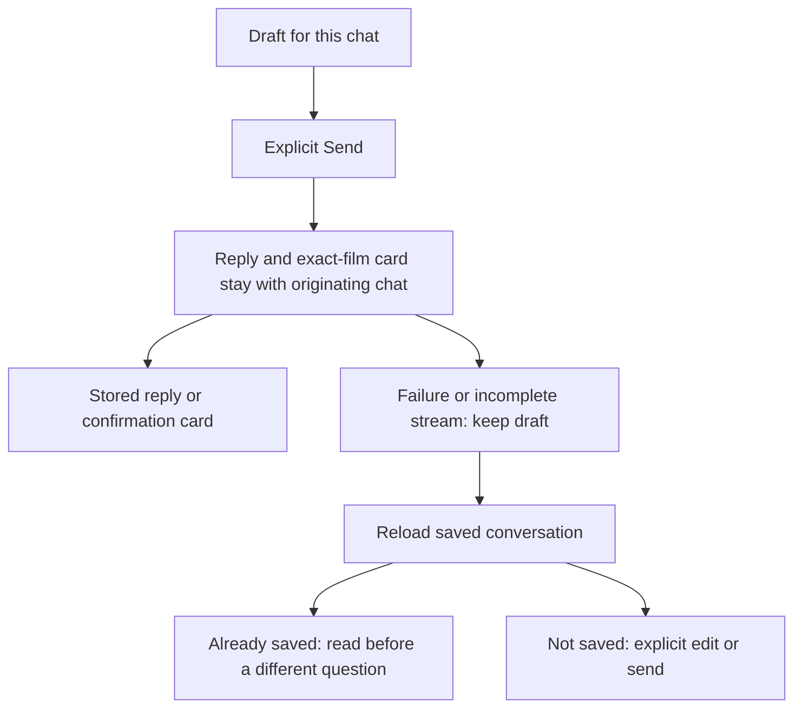
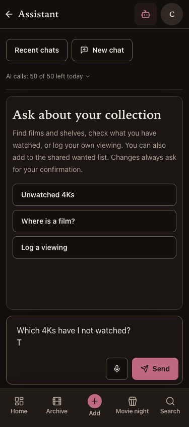
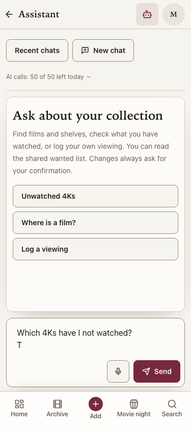
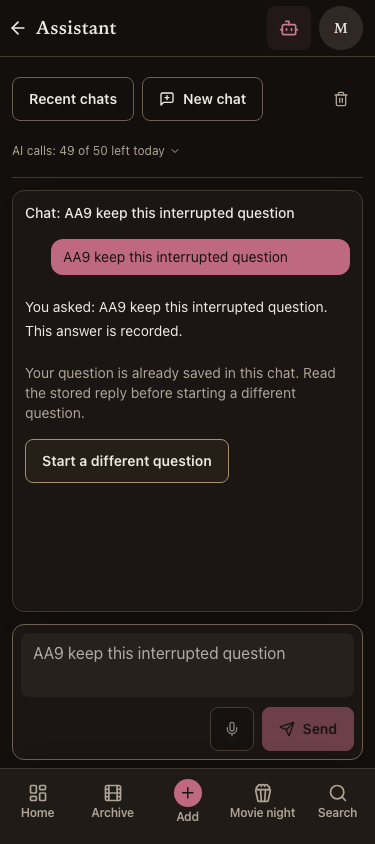
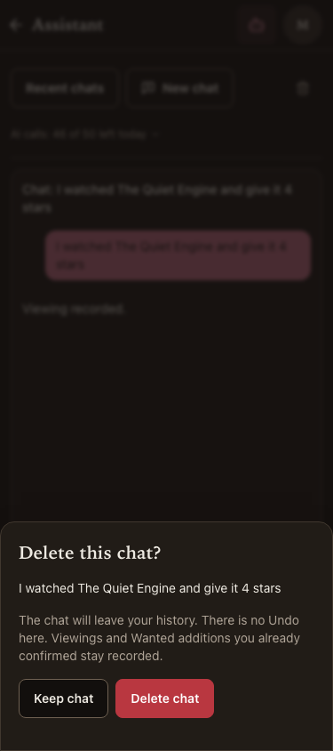

# AA9 — assistant verification

27 Oct · PR #116 is open; an additional deletion/navigation repair is under verification. Not yet shipped.

Craig picked Conversation first and Include shared corrections after the review, before
planning (#300). Sitting 5 authorises AA3 then AA9 only; sitting 6 is excluded. AA3 is
already live in PR #115 (`1c73d90`), with final close-out head `b904457` and seven-job CI
40535930619 green before AA9 began. The API and web matched that SHA and full readiness
passed before this review. The concrete acceptance plan is `aa9-build-plan-2026-10-27.md`.
[AA3 verification and its complete repair record](aa3-verification-2026-10-27.md)
are retained separately; batches did not share a product branch.

## How it works

The existing top-bar entry opens a conversation-first page. Recent chats takes one tap on
phones and stays alongside the conversation on desktop. Examples fill the multiline draft;
Enter adds a line and only Send submits. Mark gets read/shared-Wanted guidance; Craig also
gets the existing admin Wanted action. Existing roles, models, caps and APIs are unchanged.

Known limits block Send and the allowance says AI calls, since a question can use several.
Unknown availability has a retry state; an unconfigured server and offline device have their
own explanation. A failed/incomplete answer never resends automatically. A confirmation's
lost response is also reloaded because its viewing/Wanted action may already have happened.
Deleting a named chat asks first and never promises to undo confirmed actions.

The transcript scrolls within the shell's height; recovery messages scroll with it and a
bounded header keeps long details from displacing the composer. Streaming follows only while
the reader is near the end. Answer text has paragraphs, simple headings/lists, emphasis,
inline code and HTTP(S) links, with no raw HTML, image fetches or guessed film links.

## Decisions made within Craig's picks

- Recent chats replaces the mobile native select; the desktop history stays visible.
- New chat remains local until its first Send; drafts remain separate while this page is mounted.
- A lost answer requires Reload before another send; already-saved questions cannot be resent
  through that draft. Reload failure keeps the guard.
- Active replies finish on their originating chat even after browser navigation; navigation
  never claims to cancel or undo a server operation.
- Formatting uses a small React text renderer, without adding a package or changing AI output.

Drafts are page memory, not durable browser storage: leaving/reloading the whole page can lose
an unsent draft. Stored chats remain server-backed. Real iPhone keyboard, on-device dictation
and a live follow-up remain owner observations. Fixture browsers do not prove those criteria.
No production chat, live provider/model call, data rewrite, migration, credential or hosting
change is performed by this batch.

## Failures and repairs

1. First focused unit run: four passed, two failed. A fresh but not-yet-caught-up stored read
   could remove the live answer; local turns now remain until saved turns catch up. A question
   legitimately appears in both transcript and preserved draft, so its unchanged exact transcript
   assertion is scoped to the message log.
2. Second focused run: 23 passed, two failed because the new tests used a matcher unavailable
   in Vitest 2. Replaced it with equivalent call-count-one and exact-argument assertions.
3. Third focused run: 24 passed, deletion failed its exact-argument assertion. Passing the API
   function directly let TanStack add mutation context; the mutation now explicitly calls the API
   with only its chat ID. The fourth run passed all 25 cases.
4. The second web typecheck caught Playwright's `exact` option used with Testing Library in
   new unit tests. Removed that unsupported option; Testing Library string names already match
   exactly. The third typecheck passed. E2E typecheck passed on its first run.
5. First focused Chromium run: five passed, one failed. The new browser-Back case inherited
   Desktop Chrome's viewport while asserting a phone-only Recent chats control. Set its phone
   viewport explicitly; the disabled-control assertions remain unchanged.
6. A concurrent lint run caught Vite deleting a temporary timestamped config file while
   ESLint was reading it (ENOENT). No lint rule changed; the clean gate runs lint and build
   sequentially and E2E separately.
7. The next lint run caught three new failure-stream test doubles declaring generators
   without yielding. Their shared generator now rejects its awaited first event, preserving
   the same failure-before-any-text scenario; no rule was disabled.
8. Source review after the initial browser run caught that lengthy recovery text could crowd
   the composer on short screens. Recovery/availability messages now scroll inside the transcript
   and the header has a height limit. Added an exact above-navigation composer assertion at
   375 × 500 after recovery. Existing 320/375 px initial-screen assertions remain.

9. The first clean full gate ran API **2,491 passed, zero skips**, shared **157 passed**,
   and web **726 passed, one failed**. The unchanged date-consistency guard caught two new
   screens formatting dates themselves. Both now use the existing shared date/date-time
   helpers, retaining viewer-local reset time and the exact guard. The remaining frontend
   commands were not run after this failure; the next clean gate reruns all ten.

10. First full Chromium journey exposed two integration failures after the clean gate:
    the selected chat title had moved into the log and exactly duplicated its first user
    turn; it now says “Chat:” before the title, leaving the existing exact message-count
    assertion unchanged. The older confirmation-race case then found the fixture model's
    hard-coded `toolu_e2e_1` colliding with AA9's earlier write card in the database's unique
    constraint. The fake now emits a fresh tool ID per response (streamed and ordinary),
    matching the real contract; production source/constraints are unchanged. Added a fixture
    regression using the real SDK to prove four distinct tool uses across both response forms.
    Stopped this in-progress browser run before repeating the same known issues in Firefox;
    it is not a completed full suite. No browser retry or assertion change.

11. Final source review found that deletion's success callback could use its old router
    after the assistant page unmounted. The new regression's first run caught a test-helper
    scope mistake (`settle` was inside another describe); corrected the test harness. The
    next run reproduced the real navigation from `/elsewhere` back to `/assistant` when
    the held deletion finished. The success callback now refreshes shared cache regardless,
    but changes page state/URL only while that page is mounted. All **26 focused cases passed**
    after the guard, including the unchanged exact `/elsewhere` assertion. The first PR
    head's CI is superseded for merge purposes; the repaired head needs fresh full proof.

The empty successful stream fake now emits the real protocol's `done` frame. A separate
premature-EOF case proves recovery rather than allowing silent completion. The owner-picked
layout updates the old native-select assertion to Recent chats/New chat while retaining stored
history/follow-up and stale-confirmation-race assertions. The known-cap browser case asserts
disabled Send and still directly proves the real endpoint's SSE denial; server enforcement,
route inventory and role assertions remain intact. No new skip, retry, ignore or disabled check.

## Verification checkpoints

Focused unit checkpoint: **25 passed**. Web and E2E typechecks passed. Initial web lint passed
with 11 existing Fast Refresh warnings, without new exceptions. All **six focused Chromium cases passed** after the explicit viewport correction. The
short-screen recovery geometry also passed. Final full clean gate/browser evidence is pending.

| Acceptance | Proof | Result |
|---|---|---|
| Chosen layout and role-aware first screen | Both roles, both themes, 320/375 px, short and desktop viewports; starters do not call the model | Local pass |
| Multiline draft, allowance and truthful failures | Unit states, known call/spend cap, offline, status/usage failures, fixture unconfigured page | Local pass |
| Safe recovery and chat isolation | Premature EOF after real server save, no duplicate send, lost confirmation, URL-change origin isolation | Local pass |
| History and named delete confirmation | Loading/error/reload, separate drafts, cancel/confirm deletion; confirmed diary entry survives | Local pass |
| Readable answers and reader control | Safe text/links tests, partial markup, scroll-away/latest behaviour | Local pass |
| Existing app contracts and full journey | All ten local checks and full available E2E pass; exact-head seven-job CI follows | Local pass; CI pending |
| Production deployment | Exact API/web merge and final docs SHA; db and five integration readiness fields | Pending |

## Rendered evidence

Actual built-app fixture screenshots are saved after browser checks and visually inspected.
They use disposable Postgres and the outside-world fixture; they are not production accounts
or model replies. The earlier review's in-app browser API block was not bypassed; these are
normal repository E2E checks of the built app.

Inspected initial screens at 375 px: Craig in dark mode and Mark in light mode. Both
show the correct role guidance, allowance, multiline draft and Send above the five tabs.

## Integration repair checkpoint

The fixture regression passed **nine cases** including real-SDK streamed and ordinary tool
IDs. The combined AA9 and existing chat browser cases passed **all ten in Chromium** after
the title/fixture repairs, including #287's held early-record write-card race and call-cap
enforcement. No assertion or skip changed. A fresh clean full gate follows on the new tree.

## Final clean local gate — `cf28d05`

All ten `batch-verify.md` commands passed on clean commit
`cf28d051562ff5a2c61894aaacb6a3f539ac2bcc`; the tree remained clean. API **2,492 passed,
zero skips** (including all 16 derived-field trigger cases); shared **157 passed**; web
**727 passed**. Python/web lint, Python formatting/mypy, both typechecks and builds passed.
Web lint retains 11 existing Fast Refresh warnings; there is no new exception. E2E typecheck
also passed. The prior `8a34095` clean gate passed all ten with 2,491 API tests before the
additional fixture-ID regression; it does not replace this final gate.

The final full local run has completed Chromium **47 passed** and Firefox **46 passed, one
existing documented dictation skip**. All **six cron cases passed** on a fresh fixture database. WebKit is CI-only on this Mac.
No new skip or retry was added. The combined repair-run captures above were visually inspected
at phone size: recovery keeps the saved answer and locked draft readable, and the delete sheet
names the chat and warns that confirmed actions survive. A 375 × 500 assertion pins Send above
the navigation after recovery; expanded screen captures are fixtures, not physical iPhones.

All local E2E projects completed normally on this final run. The app/shared/test source is
unchanged from the clean `cf28d05` gate; the following review/status checkpoint changes only
documentation. Seven exact-head PR jobs, then merge/main CI and production API/web SHA/full
readiness, remain required before calling this shipped.

## Post-review navigation repair

The earlier complete clean/local browser evidence above belongs to `cf28d05`. The small
additional deletion guard has a focused real-router unmount regression. A new clean ten-check
gate and full available browser suite follow before merging; the final exact-head PR CI also
runs all three browsers. No production deployment has occurred for AA9.
