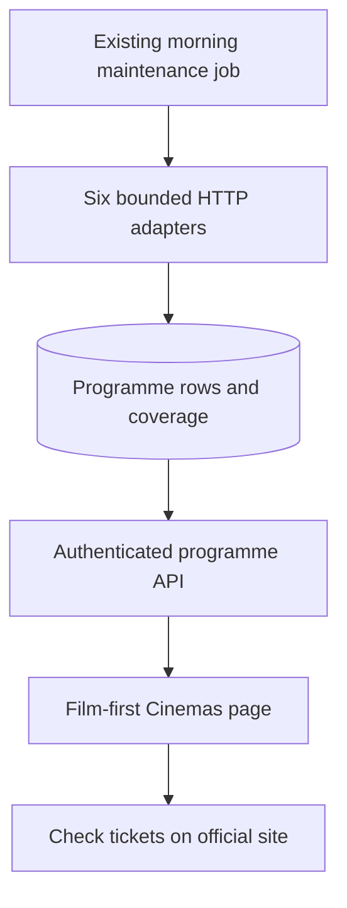

# Nine-venue cinema discovery — revised build contract

> Accepted amendment (#330): Vue today/tomorrow, bounded cached free TMDB candidates,
> exact reviewed corroborated mappings, strict run definitions retained, and preparation
> of one existing-job token reference. This supersedes this original contract's exclusion
> of metadata requests/token-reference preparation, not its explicit live/production gates.
> Current implementation/verification stop: [amendment report](ab6-metadata-amendment-2026-11-02.md).

2 Nov 2026 · decisions #325/#326/#327 · **build contract accepted by Craig**.

This is the complete current proposal for Group AB sitting 5. It supersedes the 31 Oct
contract and its browser/paid-provider amendments. “Proceed” after #324 authorises preparing
this contract and bounded source checks, not accepting new data/refresh/navigation choices.
Craig’s subsequent “proceed” accepts this revised contract (#327), including the run-based
release filters. Integrate the planning handoff before implementation. Exact production
dry-run/write/enable checkpoints remain separate; collection seeds disabled.
Craig subsequently requested newer films and a New releases versus any Older films filter
(#326). That scope is included below; the earlier ten-year Older films proposal is withdrawn.

## The decision in plain English

Use free public listings for all nine venues, refresh them each morning using the existing
08:00 UTC maintenance/reminders job, and show one film-first cinema page with All films,
New releases, Older films and Unclassified filters. No extra hosted
service, subscription, browser VM, credential or hosting configuration is proposed.

Daily updates can miss changes later that day. CinemaTimes itself publishes twice-daily
collection, not live ticket availability. Show the last successful check and uncertain
upstream age; use “Check tickets”, never “Available”. Unknown film identity and disappearing
showings stay visible as uncertain rather than being matched or cancelled by guesswork.

The data subscription is £0. The existing Railway/Neon resources still do work: incremental
compute, storage and bandwidth are unmeasured and are not guaranteed to add £0 to their
existing bill. No paid tier, spending-limit change, new service or provider fee may be
introduced under this approval. An absolute zero increase in the hosting invoice is not
established by this plan; if that is also required, stop for cost proof before enabling it.

Reject the paid API because it violates the data budget. Reject another browser VM because
ordinary HTTP now works on the current runtime. Reject running collection inside phone GET
requests because every app visit would depend on six external source families. Reject
coupling cinema updates to shop-price/eBay passes. The existing morning job already performs
household maintenance, health checks and weekly Letterboxd sync; one bounded, separate
cinema phase there is a deliberate change from the earlier separate-worker proposal.

## Scope, evidence and honest coverage

| Venue | Proposed source | Evidence and remaining limit |
|---|---|---|
| ODEON Kilmarnock | CinemaTimes dated HTML | 137 rows on 1 Nov; 112 on 2 Nov. Official 1 Nov IDs/times match 34 rows; two title conflicts. |
| ODEON Glasgow Quay | CinemaTimes dated HTML | 269 → 223 rows; seven observed dates per pass. |
| ODEON Braehead | CinemaTimes dated HTML | 262 → 209 rows; four missing future Wicker showings need an uncertain state. |
| ODEON East Kilbride | CinemaTimes dated HTML | 201 → 163 rows; seven observed dates per pass. |
| Cineworld Glasgow Silverburn | Observed public schedule JSON | 18 Railway sessions on 31 Oct; one sampled date, not complete horizon. |
| Vue Glasgow St Enoch | Observed public schedule JSON, cinema 10097 | 19 Railway sessions on 31 Oct; one sampled date. |
| Everyman Glasgow, Princes Square | Observed public schedule JSON, venue X11DQ | Six Railway sessions on 31 Oct; local business-day/date boundaries need care. |
| Glasgow Film Theatre | Official listings and observed public listing data | 20 showing references on 31 Oct; SEO HTML may expose only a short window. |
| Glasgow Science Centre IMAX | Official IMAX page → public Ticket Tailor box office/events | Nine event identities initially found; one future event checked on Railway. Discovery completeness unproved. |

All nine stay in scope; Science Centre IMAX stays distinct from Cineworld Silverburn. No
five-venue or links-only substitute. Six adapter families: CinemaTimes, Cineworld, Vue,
Everyman, GFT and Science Centre/Ticket Tailor. The four ODEON branches retain separate IDs.

On 1 Nov the four CinemaTimes pages yielded identical local/Railway bodies and 869 rows.
On 2 Nov four ordinary local GETs yielded 707 rows for 2–8 Nov: 667 retained IDs/starts,
40 new IDs, 202 removed IDs. Of those removals, 198 were past and four were future Braehead
Wicker starts on 2 Nov. Those four are neither confirmed cancellations nor confirmed source
errors. The update label changed from Sunday 06:19 to Monday 06:17; timezone/date semantics
and sustained reliability remain unproved. No Railway recheck on 2 Nov is claimed.

JSON-LD exposes only 50 events/page in these specimens; the collector must use dated HTML,
not silently import those 50 as the whole programme. All 200 JSON-LD starts match HTML in
each pass. The 2 Nov audit is alongside this contract. Earlier specimens/audits remain
`ab-cinema-free-source-results-2026-11-01.*` and `ab-cinema-repeatability-2026-10-31.*`.

Target today plus 13 Europe/London calendar dates. Each adapter must discover its actual
window from real responses; the four ODEON pages currently demonstrate seven dates only.
Dates outside observed coverage say “Programme not checked for this date”, never “Nothing
showing”. Source truncation, missing pages and request limits make coverage Partial. This
approval would accept variable, explicitly displayed source horizons, not complete 14-day
coverage. An adapter with an unproved discovery procedure blocks live acceptance for that
venue; fixtures or a successful subset cannot certify all nine.

Source entry points/booking hosts come from the existing specimens, not guessed APIs.
No What’s On retry, direct ODEON refusal retry, archive request, operator contact, signup,
paid proxy, access-control bypass, model call or unrelated sitting. Owner permission to try
restricted sites remains valid; no new consent is sought merely for restrictive terms.
No affirmative recurring reuse grant has been established from the inspected pages;
this proposal does not claim operator consent or make a legal determination. The existing
permission, including restricted sites, applies to the proposed public collection if this
contract is approved; this is not another request to approve those same restrictions.
New access/payment/credential requirements or technical refusals stop the affected adapter.

## Proposed flow

This is a proposal, not the deployed architecture. Update the existing architecture map
when AB6/AB7 land; leave it describing the current app until then.

## Data, identity and matching

Five new tables, UUID IDs, UTC_NOW defaults, naive UTC domain timestamps and soft deletion:

| Table | Contents and uniqueness |
|---|---|
| cinema_venues | Nine seeded venue rows, source/operator IDs, timezone, source/official URLs, collectionEnabled default false. Unique source/operator venue pair. |
| cinema_films | Source film/event key/title, nullable verified TMDB/catalogue ID, original year/evidence, separately evidenced first UK theatrical/source/reissue dates, identity status and provenance. Unique source/film key. |
| cinema_screenings | Venue/source showing key, film/event, UTC start and optional end, original local/date/offset, formats/screens, validated booking URL, release category/confidence/evidence, first/last seen, confirmation state/evidence. Unique venue/source showing key. |
| cinema_refresh_runs | Adapter version, run trigger/state, bounded counters, lease/expiry, started/finished UTC and per-venue/date outcome snapshots for history. No raw bodies or credentials. |
| cinema_coverage | Venue/local date, requested/observed bounds, completeness, last attempt/success, source update label and optional evidenced upstream timestamp, per-venue outcome. Unique venue/local date. |

Explicit source showing IDs take precedence over synthetic title/time keys. An event with
several times has several screenings. Everyman/Ticket Tailor keys currently include time
and are weak reschedule identities: a move is not a proven preserved identity. Deduplicate
overlapping responses without collapsing distinct screens, formats, venues or occurrences.

Use existing verified catalogue/TMDB identity only when an explicit external ID or already
verified mapping supports it. No title-only merge, implicit remake match, copied poster-key
identity or live provider search in this version. No extra TMDB credential is given to the
morning job. Unknown film matches remain source-scoped groups labelled “Identity unverified”.
This may leave duplicate-looking groups across providers; the UI must explain uncertainty.
Do not promise every source film will automatically join the owned catalogue.

Combined programmes and opera/live events remain event identities. The known official
“Tabby McTat + The Room on the Broom” versus publisher “Tabby McTat” conflict cannot inherit
a single-film match/year/watch status. Preserve both evidenced labels and show “Programme
title differs — check cinema”; require a verified resolution before grouping it as one film.
The earlier official sample is historical evidence, not a permanent title override.

Original year is nullable and separate from a reissue/source release date. A source's
dateCreated or release year alone cannot establish original release. Use verified existing
identity/year or corroborated original-year evidence, otherwise “Year unverified”.

### Release-category filter — revised after Craig's request (#326)

The collector gathers current programmes without excluding new releases. All films is the
default; provide one release-category selector with these choices:

| Choice | Proposed meaning |
|---|---|
| All films | Every observed programme, including uncertain identity/category and live events. |
| New releases | Evidenced current first UK theatrical run. |
| Older films | Evidenced return/repertory/reissue showing after an earlier release, of any age. |
| Unclassified | First-run versus returning status lacks evidence, conflicts, or does not apply to a combined programme/live event. |

This removes the unapproved ten-year cut-off. A film first released last year and returning
now can qualify as Older films; it need not be ten years old or unwatched. An older original
film's first UK theatrical run can qualify as New releases, while still displaying its
original year. These are proposed run-based definitions, not an assumed 90-day/12-month
age rule. Craig accepted these definitions in #327; a later change needs a superseding decision.

Classification needs explicit source run/reissue evidence or corroborated release history
and a resolved film/screening identity. A recent year, dateCreated, booking link, collected
time or a reissue's current release date is insufficient. Do not infer first-run status
solely from a first UK release date or the absence of a reissue tag. No new live metadata
provider/API/credential or model call is authorised to fill gaps. Classification completeness
is unproved for the existing specimens; source limitations may leave many rows Unclassified.

Store a per-screening release category and its evidence, because the same film can have a
normal run and a distinct retrospective/event showing. Preserve film release-history
evidence separately. API category values are newRelease, olderFilm or unclassified;
filter value all includes every category. Return category/confidence plus original-year
confidence independently; a verified original year need not establish the screening's run.

Show category counts for the selected date/venues before applying the category filter and
keep Unclassified visible. “No verified older films found” must not imply no older films
exist when unclassified rows remain. Original-year uncertainty, reissue badges, observation
freshness and coverage are separate labels. Watched favourites remain eligible. Ownership
uses owned_copy(); watch status is personal.

Preserve local date/time, business-day boundary and source offset. Convert once to UTC;
display Europe/London. A local DST fold/gap without an offset is quarantined, not guessed.
Unknown end time stays null. An after-midnight Everyman showing uses its actual civil date,
not automatically the selected 03:00–03:00 business day.

## Refresh, disappearance and freshness

Refresh **once daily at the existing 08:00 UTC run** (08:00 GMT/09:00 BST). The job's hosting
schedule/start command/credentials do not change. The separate cinema phase runs after
existing reminder delivery/commit/heartbeat, uses independent sessions/transactions and
has a five-minute total deadline. Cinema failure cannot roll back delivered notifications,
existing health results or Letterboxd work. It records its own outcome/heartbeat; the
reminder return status retains its current meaning. Cinema failures appear in programme
coverage and structured job logs, without a new film/showing notification or push category.
The log reports both outcomes explicitly: a green reminders exit is not cinema success.

A standalone `refresh_cinemas` command uses the same service for source dry-run, approved
ingest and operational diagnosis. Dry-run reports exact row/coverage/conflict changes and
writes no programme/run/heartbeat records. No public refresh/matching/enable endpoint.
New venue rows seed collectionEnabled=false: deployment alone cannot start source requests.
After live acceptance and exact-count review, owner approval enables the nine rows through
an audited command; disabling them stops later scheduled reads without deleting history.
Live write/enable commands and row counts are presented separately before execution.

One global lease, ten-minute expiry, a live owner/renewal check and fencing at promotion
prevent overlapping cron/manual runs or a timed-out worker publishing after replacement.
Fetch/parse outside transactions; promote one validated venue/date snapshot atomically.
Failed/quarantined snapshots do not replace successful rows or reset their last-seen time.
One venue failure cannot mark another venue's coverage healthy or empty.

Ceilings per run: 120 programme/discovery/metadata GETs, 2 MiB decoded body per response,
64 MiB total, two requests globally in flight, one per host with at least one second between
starts, 15 seconds total per fetch, five minutes overall and 10,000 normalised screenings.
Metadata uses the same allowlist and budget; no image/script/browser-asset downloads.
Stop the affected host on 401/403/429/challenge, with no retry or alternate provider. Caps,
parser failures and unexpected redirects are Partial/Failed, not Empty. Enforce response
limits while streaming; an in-flight chunk may exceed the stop threshold slightly.

Missing future row inside an observed date: mark **Unconfirmed**, disable that showing's
booking action and offer the official programme. Do not call it cancelled. This applies
even when the source snapshot's completeness is unproved. An explicit cancellation can
be Cancelled; absence in a proved-complete snapshot can be Withdrawn. Rows outside observed
bounds keep their last-seen age and cannot inherit a refreshed date's freshness. Started,
ended, cancelled, withdrawn and unconfirmed rows never have an active showing booking link.

Keep four separate facts: last attempt, last successful fetch, last sighting of each row,
and upstream collection evidence. Display “Checked [time]” alongside “Source update time
unverified” when the source label has no defensible date/zone. The Monday/Sunday text may
be displayed as source text but never converted silently into a precise UTC timestamp.

Daily policy: fetch/row observations older than **30 hours** are Stale. If an evidenced
upstream timestamp exists and is older than **36 hours**, treat that data as Stale too.
These are proposed usability limits for a daily collector, not a provider guarantee.
No upstream timestamp means Unknown upstream age, not proven fresh. A failed latest
attempt disables showing booking actions for that venue immediately. Beyond stale, retain
last-known rows for context with official programme links; do not imply ticket availability.

First-load failure = Unavailable. Complete validated zero = Empty. Incomplete discovery,
date range, parsing or response = Partial. Disabled = Not enabled. Healthy means current
successful observation of a proved-complete window, never a whole-provider availability
claim. Preserve these states and freshness even when filters hide every film. One missing
venue/date prevents a blanket “all nine checked” claim for that selection.

## API, screen and retention

Add authenticated GET `/api/v1/cinemas/programme` only. Query dateFrom/dateTo (inclusive,
maximum 14 local dates, default today), venueIds and releaseCategory
(all/newRelease/olderFilm/unclassified, default all); reject unknown categories/venues,
inverted dates and oversized ranges. Return a direct camelCase response: generatedAtUtc,
window, all nine venue/coverage records, film groups and distinct showing rows. Include
identity/year confidence, per-showing release category/confidence/evidence, category counts,
observation/source-age states and nullable validated booking URL.
Limit the response to 2,000 showings; expose truncation and a clear “Narrow your date or
venue selection” message, never silently present a complete programme. Ordering is stable
by start/venue/showing ID. No source requests, refresh or writes on GET.

The shared zod schema ships with the endpoint. Extend the pinned route inventory by this
exact GET; retain auth/equality assertions. Guard grants to mcu_readonly/mcu_backup for
all new non-credential tables. New tables contain no auth/tokens. Tests prove credential
columns remain withheld by privilege queries. No collection, diary, releases or existing
watch/matching records are rewritten by programme ingestion or browsing.

AB7 adds authenticated `/cinemas`, grouped by verified film identity; unresolved groups
stay separate and labelled. Date/venue filters, the release-category selector and per-showing venue,
time, format if actually supplied, freshness and Check tickets. Home discovery link plus
desktop Plan a screening/command palette and mobile You entry; retain the five bottom
tabs and existing disc-release calendar. Navigation/access inventory changes require this
explicit approval. No checkout/payment/cart, booking submission, new assistant tool or push.

Show source attribution including CinemaTimes for ODEON, with a source-page link and
official programme fallback. Only observed HTTPS operator/box-office hosts and expected
booking paths are allowed; reject javascript/data/credentials/private-host URLs. External
links isolate the opener and suppress app referrers. Offline/cache age must suppress stale
showing actions even before refetch. Test 375 px/both themes, keyboard/loading/empty/error/
partial/unconfirmed/offline states and personal watch-status isolation.

Retention: ended/withdrawn/unconfirmed screening history 30 days after end/start; runs and
coverage history in run outcome snapshots 90 days; source films 90 days after their last
screening. Current coverage stays unique by venue/date; history is not lost on upsert. Purge only this
new cinema domain with bounded batches; never cascade into catalogue, diary or releases.
No production raw-body/image corpus or copied plot text. A downgrade drops only new cinema
tables in throwaway migration tests; production rollback never auto-downgrades populated
tables. Measure incremental database size during acceptance; capacity pressure blocks
enablement rather than buying a tier or deleting unrelated data.

## Batches, acceptance and remaining owner stops

Two implementation batches, sequential from clean green main, one branch/PR each. The old
browser-dependent AB6a/AB6b split is withdrawn, not silently adopted. Integrate/review the
research/planning branch through the normal checks before implementation; never mix its
history or AB7 code into AB6. No force push/amend, worktree switch or unrelated cleanup.

| Batch | Scope | Required acceptance |
|---|---|---|
| AB6 — ingestion | Five tables, six adapters, GET/shared schema, disabled morning phase/CLI, retention/coverage and architecture map. Ledger setting: Opus 5 xhigh / GPT-5.6 Sol Extra High. | Real-specimen fixtures; real-Postgres atomicity/lease/fencing/rollback; IDs/overlap/double bill/year/run-category/DST/midnight/failure/zero/unconfirmed regressions; migration/grants/backup/image/job tests. New first run, last-year returning film, old-film reissue, first UK release of an older original, mixed/unknown categories and invalid category cases. All-nine live discovery and exact dry-run review before approved ingest/enable. |
| AB7 — discovery | Film-first `/cinemas`, category/date/venue filters/labels/coverage/navigation/links and map. Ledger setting: Sonnet 5 high / GPT-5.6 Terra High. | Accepted AB6 coverage and approved contract; browser → API → stored fixture journey for each category/count, unknown coverage, watched older favourites, personal isolation, 375 px/themes and all failure/offline/link states. Read-only real programme/render comparison after deployment. |

Each batch needs every batch-verify command, meaningful local throwaway DB/E2E checks where
available, exact-head seven-job PR/main CI with no unexplained skips, merged API/web SHA
and db:ok readiness. Report local DB/browser platform limits honestly; never test against
Neon to fill that gap. No production ingestion acceptance from green fixtures alone.

The full source/cost/coverage/year/freshness/navigation contract is accepted (#327).
Owner stops remain: approve exact live dry-run/read scope where not already covered; review dry-run row counts,
identity conflicts and coverage before any write; approve the nine-row enable; re-plan
source/hosting/credential/budget changes or unmet all-nine acceptance. No silent five-venue
close-out. Runtime tests already approved/completed are not being re-approved.

Engineering cost: two separately verified implementation PRs with six adapters, shared
schema/migration/E2E work and ongoing markup maintenance. Source changes may require a new
approved split. No reliable completion-time or hosting-bill estimate exists yet. AB6 must
report request bytes/duration/new row counts/storage delta so enablement is reviewable.

**Accepted decision (#327):** this contract is the build basis, including daily refresh,
30-hour observation/36-hour evidenced-upstream stale limits, variable explicit horizons,
All/New releases/Older films/Unclassified run-category filter without an age cut-off,
uncertain identity/disappearance handling and the existing-job
integration. This approval starts AB6 only after the planning handoff is integrated on
clean green main; AB7 follows accepted AB6. It does not approve production writes/enabling,
paid access, new hosting/credentials or AA10c/any other sitting.
