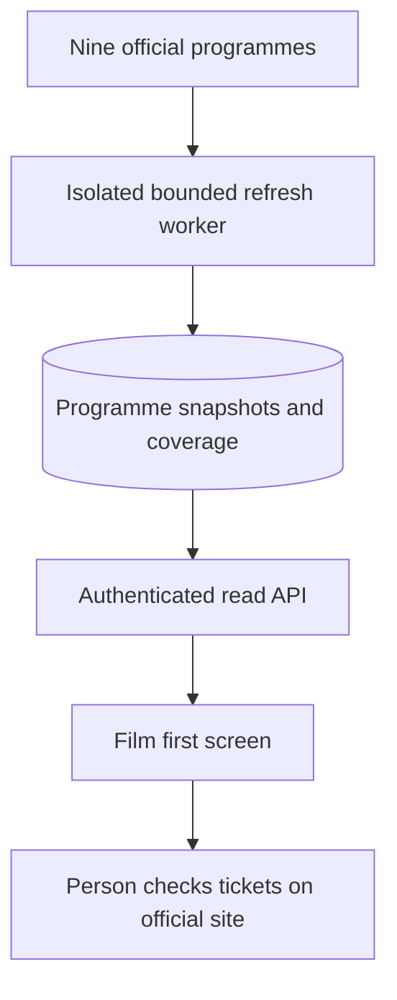

# Nine-cinema ingestion and discovery — proposed contract, 31 Oct

**Proposal for review, not build approval.** Craig authorised source experiments; the
schema/API/job/refresh/retention/navigation decisions below still need his approval under
Group AB's owner checkpoint. All nine venues and the Film first concept remain the intent.
This replaces neither the ledger nor the deployed architecture map until accepted/built.

**1 Nov source re-plan hold (#322):** after the earlier runtime/check-defect stops, the
approved replacement VM passes the full sandbox/renderer/local-rendering check. All four
ODEON venue URLs then return HTTP 403: four GETs, zero samples, no repeat. The VM is stopped
and cleaned up. The proposed ordinary hosted-browser stage has not met source acceptance;
do not start AB6a/AB6b/AB7 or approve the staged build on that assumption. Establish a new
obtainable ODEON programme route and its coverage/cost, or an explicitly accepted owner-
supplied capture/import workflow, before revising this contract. All nine/Film first remain
intended; no route/split/build/recurring host is approved. Current result and audit limits:
`ab-cinema-vm-source-result-2026-11-01.md` and JSON. Earlier experiment text is historical.

**1 Nov research direction (#323):** owner delegates feed-access research. UK Cinema API
Lite is the first coverage/evaluation enquiry candidate, not an approved source or budget.
If it proves suitable, prefer one HTTP API for all nine; assess a hybrid only against actual
coverage without losing either independent. Lite format omissions, mostly-nightly upstream
collection versus this draft's six-hour polls/eight-hour freshness, and cancellation-time
cache/fixture/backup deletion require explicit re-planning. No recurring browser VM or
unchanged adapter split should be assumed. Unsent enquiry and comparison:
`ab-cinema-feed-research-2026-11-01.md`. Contact, evaluation and full build gates remain open.

## Evidence-driven change to the plan

Five venues have structured/HTML programme responses in the existing Railway Linux runtime:
GFT, Vue St Enoch, Everyman Glasgow, Cineworld Silverburn and Science Centre IMAX. Four
ODEON branches render in the in-app browser but their Railway pages return 403; the one
observed public schedule URL returns 401 without authentication. The current API image has
no browser. All-nine specimens therefore do not yet establish an all-nine deployable feed.

Reject putting source scraping in the phone/browser request path: it would make app reads
depend on operator availability and transfer refresh costs to every visit. Reject attaching
cinema work to the price job: its daily timetable, retries and price/notification semantics
do not fit a programme snapshot. Reject shipping five venues as the agreed nine or calling
the parked link directory a Film first programme feature.

The proposed sequence is a source-runtime experiment, then **three implementation batches**.
They remain within sitting 5's cinema objective; no other sitting starts. Proposed AB6a/AB6b
are a split of AB6, not approved ledger entries. Each implementation has one branch/PR,
starts from clean green main after its predecessor, and receives its own full close-out.
Retain the recorded AB6 Extra High setting for both proposed splits; AB7 retains its
recorded High setting against the accepted contract. No new model/effort is invented.

| Stage | Deliverable | Stop before proceeding |
|---|---|---|
| Source runtime experiment | Prove or fail ordinary unattended ODEON loading on Linux, with request/runtime measurements. | Explicit hosting approval below; then review evidence. |
| Proposed AB6a | Programme store/read API, bounded HTTP adapters for the five currently accessible venues, fixture-backed job entry point; no production schedule or public discovery screen. | Approve this contract, exact route additions and live dry-run scope first. Partial source capability is reported as partial. |
| Proposed AB6b | Four ODEON adapters and isolated browser worker if the experiment succeeds; all-nine source acceptance and scheduled refresh. | Approve actual worker/image/cost/hosting plan and exact live write/enable scope. Stop/re-plan if ODEON fails. |
| AB7 | Film first discovery using the accepted nine-venue data contract. | AB6 acceptance/actual coverage and navigation/year/freshness picks confirmed. |

## Immediate next experiment — exact approval scope

**Approved 31 Oct (#318):** Craig replied “approve” to this temporary experiment only.
The later application contract and batch split remain unapproved. Execution/results are
recorded separately; this approval does not enable a recurring source job.

**Completed with a runtime block (#319):** three sandbox-enabled browser launches failed
before any cinema request; all temporary services removed. Results and the next runtime
policy decision: `ab-cinema-hosted-browser-probe-2026-10-31.md`. The proposed browser stage
below is on hold. The previous approval does not approve sandbox-off operation, another
host or the full build. Re-plan from that evidence before AB6/AB7 implementation.

Create one temporary Railway service **cinema-probe**, isolated from the API and every cron.
It has no database, app, VAPID, TMDB, model, eBay or other credentials; no inherited production
variables or volumes; no public domain or schedule. Use a pinned ordinary Chromium/Playwright
image built from recognised packages, with no stealth/fingerprint changes, proxies, copied
browser sessions, CAPTCHA service or direct authentication-header reuse.
Limit this temporary service to one replica, 1 vCPU and 2 GB RAM. Do not expand the existing
project's spending/plan limits or change any other service to make the experiment fit.

Test the four exact official URLs: `/cinemas/kilmarnock/`, `/cinemas/glasgow-quay/`,
`/cinemas/braehead/`, `/cinemas/east-kilbride/` on `https://www.odeon.co.uk`.
Two passes use fresh non-persistent contexts, separated by at least five minutes. Per venue,
load the default programme, select tomorrow through the ordinary UI, record day/readiness,
showing IDs/times/booking references and close the context. Maximum eight contexts and
16 selected-day observations; 120 allowed network requests/context; 15 MB received/context;
90 seconds/context; 30 minutes total. Block images, fonts, video, known trackers and account/
checkout/cart/payment navigation. Only observed public page dependencies are permitted.
If budgets prevent completion, report partial rather than raising the limits silently.

Stop a venue on a challenge, credential demand, refusal or exhausted budget. No automatic
retry; the second pass checks successful first-pass venues only. Extract only public
programme DOM/ordinary responses, never secrets or hidden account state. Do not follow a
booking URL. A selected day with previous-day rows is an incomplete load, not a success.

Keep minimal JSON counts/IDs/times/failures, resource measurements and one screenshot per
successful venue; do not publish copied film text/images. No programme data is written to
the app. Stop the worker after the run and remove this temporary service/build artefacts
under the same explicit approval. Existing services, variables, secrets and domains stay
outside this change. No recurring worker is authorised by a successful experiment.

**Cost:** source subscription £0; up to 30 minutes of additional Railway build/compute and
network use. Railway's published service rates checked 31 Oct are $0.00000772/vCPU-second,
$0.00000386/GB-second and $0.05/GB service egress. At the proposed maximum 1 vCPU/2 GB for
1,800 seconds, runtime compute is about **US$0.028**, before build/network/tax; existing
account credits and the actual bill were not inspected. This calculation is an estimate
from [Railway's pricing](https://railway.com/pricing), not a guaranteed currency cap. Byte
limits are stop thresholds and can overshoot by an in-flight response. Provision/run/remove
is a hosting change and requires
Craig's explicit decision. If it fails, report the evidence and compare an operator feed
or separately approved provider; do not buy or reduce venues automatically.

## Proposed data contract

Programme data is a separate domain from releases, owned copies and diary entries. Opening
or importing a programme creates no catalogue film, owned copy, watch entry or notification.
Six adapter families: ODEON, Cineworld, Vue, Everyman, GFT and Science Centre/Ticket Tailor.
The four ODEON branches share an adapter but keep distinct venue/source IDs.

This is the proposed flow only; the current architecture map continues to describe the
deployed app, which has no venue-programme pipeline.

Proposed tables, UUID primary keys and guarded read/backup grants on all non-credential fields:

| Table | Contents/invariant |
|---|---|
| cinema_venues | Nine seeded local IDs, operator/source venue ID, Europe/London, name and official programme URL. Unique operator/source venue pair. |
| cinema_films | Source-scoped film/event ID, source title, nullable original year with evidence, separate source/reissue release date, nullable verified TMDB/catalogue match and match provenance. Unique source/film key; ambiguous matches remain unresolved. |
| cinema_screenings | Venue, source film, stable source showing key where supplied, identity strength, UTC start/end, source local value/zone/offset, screen/formats, allowlisted booking URL, source availability, first/last seen times, cancellation/withdrawal evidence and soft-delete state. Unique venue/source showing key. |
| cinema_refresh_runs | Trigger, adapter version, lock/lease state, request/byte/duration counters, started/finished UTC, per-venue outcome/counts/errors; no credentials or full source bodies. |
| cinema_coverage | Per venue/window: requested bounds, actually observed bounds, completeness evidence, last attempt/success, empty/partial/failed outcome and last successful run. A failed attempt never overwrites successful coverage as empty. |

Store naive UTC and use UTC_NOW defaults; return offset-labelled wire timestamps. Retain the
original local timestamp/offset for diagnostics. A nonexistent or ambiguous local DST time
without a source offset is quarantined; never silently choose a fold. A source business day
can extend past midnight, so do not attach every HH:MM to the selected calendar date by
assumption. Verify each adapter's date boundary before live acceptance.

Use opaque showing IDs where supplied. Everyman's ID embeds time/tags and Ticket Tailor's
observed occurrence key is event ID + start: these are weaker reschedule identities. Do not
claim a moved occurrence is the same screening without evidence. Keep source provenance and
deduplicate repeated reads by the actual source key. Only a confirmed film identity can
group across sources; title alone cannot merge remakes or distinct editions. Separate
formats/screens/showings remain distinct under a film.

For a successful, proved-complete snapshot, a missing future showing becomes **withdrawn**;
only an explicit source cancellation becomes **cancelled**. Partial/failure/timeouts cannot
withdraw anything. Unverified snapshots update only observed rows and coverage. Old/new
rows are promoted atomically per venue/window so readers never see half a replacement.

## Proposed identity and older-film behaviour

Original year is separate from a reissue date. Use a verified existing film identity or
corroborated source/TMDB metadata; never source release year, popularity or title alone.
Ambiguous matches stay source-scoped with “Year unverified”. Provider searches/film-detail
reads need their own agreed budget and specimen evidence before enablement; no live model
ranking is proposed. First release/year and DST/cancellation evidence are still open.

Recommend **Older films = verified original release year at least ten calendar years before
the screening year**: for 2026, 2016 and earlier. A source explicitly labelling a reissue
gets a separate Reissue badge; an older film need not have that badge. Unknown-year rows
remain in All films, with their count visible beside the older filter. Personal watched
status never excludes older films; watched favourites remain eligible. Ownership uses the
existing owned_copy predicate and watch history is scoped to the signed-in profile.

## Proposed API, refresh and retention

Authenticated GET **/api/v1/cinemas/programme** returns one direct camelCase response with
generatedAtUtc, selected window, nine coverage records, and film groups containing distinct
venue/showtime rows. Query: dateFrom/dateTo (at most 14 local calendar dates), venueIds and
olderOnly. Reject unknown venues/dates/oversized ranges; cap at 2,000 screening rows and
explicitly report truncation as partial. No provider requests or refresh side effects on GET.
The shared zod schema ships with the route and every web fetch parses unknown through it.
Approval must include this exact pinned route-inventory addition; existing equality/auth
assertions remain intact. No refresh/matching mutation endpoint is proposed in this version.

Recommend a separate **cron-cinemas** command/worker every six hours at 00:15/06:15/12:15/
18:15 UTC. Its own heartbeat, durable single-run lease and per-venue failure reporting are
separate from price scraping. No overlapping run, restart retry, push or model call. Fetch
outside transactions, then atomically promote validated per-venue snapshots. Runtime/image/
service/schedule changes remain an explicit later hosting decision after measurement.

Target today plus 13 days, but report per-source observed/completeness bounds. GFT's current
three-date HTML and the initial Ticket Tailor event list do not prove that target. A cap,
missing page or unproved discovery step is partial coverage, never “no films”. First build
must establish each source's discovery/pagination/window procedure from real specimens.

Proposed recurring ceilings: 80 structured programme/metadata GETs plus at most four ODEON
browser contexts, 160 requests/15 MB/120 seconds per context; 2 MB per HTTP body; 15 minutes
total per run; no in-run retries. Maximum 720 requests and 220 MB per run, including browser
assets, not 720 programme navigations. Stop/record partial on a ceiling. These are design
ceilings, not measured ongoing load or permission to start a schedule. The experiment's
tighter limits apply only to that experiment. Revisit ceilings/cadence after real timings.

Fresh = at most eight hours since successful observation; Stale = older or a failed latest
attempt. Retain last-known rows for context for up to 24 hours but suppress their booking
actions once stale; offer the official programme URL. Every link says **Check tickets**,
never asserts seat availability. Suppress already-started, expired, cancelled or withdrawn
showings independently of source flags. Failed first load is Unavailable; verified complete
zero rows is Empty; incomplete source/window is Partial; a successful subset cannot turn the
whole nine-venue view Healthy. Coverage/freshness stays visible when filters hide all rows.

Retain ended/withdrawn screening audit rows 30 days; run/coverage history 90 days; unmatched
source films 90 days after last screening, with soft deletion. No raw HTML/JSON/image corpus
in production storage. A bounded retention pass purges these new domain records only under
the approved policy; it never reaches catalogue, diary or releases. Downgrades remove only
new cinema tables; deployment rollback does not silently drop populated programme tables.

## Proposed screen/navigation and acceptance

Authenticated **/cinemas**: Film first, date/venue filters, older/reissue labels, individual
venues/times and Check tickets links. Home discovery link, desktop Plan a screening entry/
command palette and mobile You entry; keep the existing five bottom tabs and disc calendar.
Unknown identity/year and all coverage states are visible in both themes at 375 px.
External links use HTTPS/operator/box-office allowlists, opener isolation and no app token or
profile in the URL/referrer. No booking is submitted. Offline/cached rows cannot retain a
fresh booking action merely because the query cache has not changed.

Before AB7 starts: accept all-nine source results, identity/year policy, observed horizon,
freshness thresholds and the concrete navigation/API contract. Test real Postgres atomic
promotion/rollback, duplicate/overlap/reschedule cases, complete versus partial zero rows,
failure preservation, DST folds/gaps/midnight, live-source fixtures, isolation of personal
watch history, withheld credentials/guarded grants, reversible migration and the production
job import/image. Browser → API → stored fixtures proves multiple venues, old/watched films,
all failure states and safe external navigation in both themes.

Every implementation batch then needs its full local gate, exact-head seven-job PR/main CI,
production merged SHA/readiness and authorised source/live-data acceptance evidence. A green
fake-source suite is not nine live venues. Current source success does not waive licences
or failure reporting. The actual shipped map is updated when the pipeline changes, not now.

## Decisions still required

1. **Now: resolve the four ODEON sources/coverage/cost after #322.** The approved runtime
   tests are finished; the sandbox-capable VM reaches four HTTP 403s. No further identical
   runtime test is proposed. A programme feed/access arrangement or owner-supplied capture
   workflow needs concrete feasibility, permission, coverage, freshness and cost evidence;
   no supplier/account/contact/trial/payment or alternative workflow is selected here.
2. **After source evidence: accept/revise the full build contract and AB6 split.** Proposed cost:
   three separately verified implementation PRs, six adapter families, new programme tables
   and one recurring worker. Subscription £0 was the earlier proposed direct-source route;
   an alternative source's fees are unknown. Ongoing compute,
   maintenance hours and source reliability remain unmeasured. No guarantee of all-nine
   recurring access can be made yet. No implementation is authorised merely by approving
   the temporary experiment.
