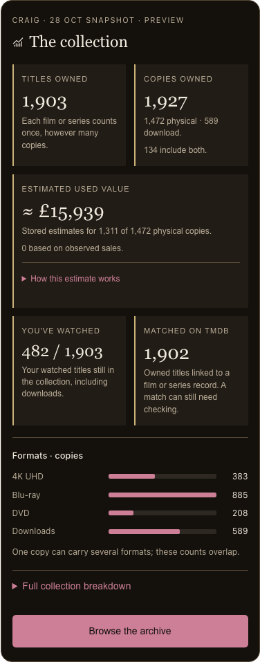
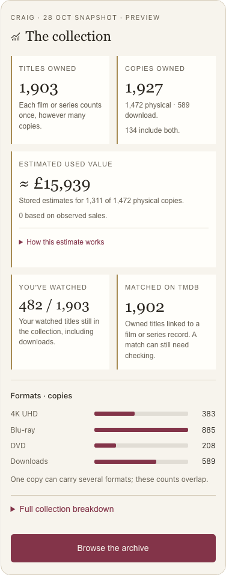
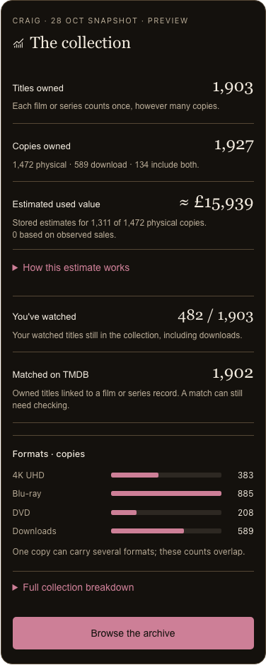
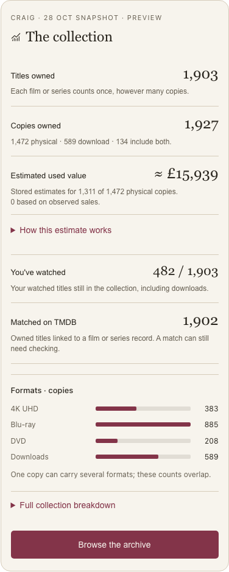

# AB2 — collection review and approval, 28 Oct

Review only. Started from clean `main` at `86e7d56`, after AB1's full close-out.
Final exact-head CI 40759704615 passed all seven jobs; API/web matched the SHA with full readiness.
Ledger tier: Deep/High. Sitting 1 only; sitting 2 and AA10c remain excluded.

## Batch title, goal and acceptance criteria (verbatim)

### AB2 — Collection descriptions, watched coverage and visible breakdown

- **Checkpoint before build:** present phone-size layout/wording alternatives; stop for
  Craig's pick. Recommendation: short descriptions, owned-watched coverage, small visible
  breakdown preview and expandable full charts. Existing five meanings stay available.
- Watched becomes the signed-in person's distinct watched currently owned titles against
  current owned titles. Rewatches/extra copies count once; downloads count; sold/donated/
  binned copies follow the canonical ownership rule. Preserve the diary and account privacy.
- Propose additive `ownedWatchedMovies` in existing stats/shared-zod contracts, preserving
  `watchedMovies` as the whole-diary metric. Obtain exact API approval with layout picks;
  old/cached responses cannot invent zero when the new field is absent.
- Explain titles/copies, overlapping formats, value coverage and matching. Keep identified
  meaning intact. Record a scoped supersession of #299 for watched and chosen presentation.
  Preserve format/location/genre/decade data and missing-spend caveats, without re-pricing.
- Regress both counts after watches and collection changes, account isolation, old responses
  and chosen design at 375 px/both themes. Full gate/E2E, exact-head CI and production
  readback; live snapshot numbers are examples, not pinned expected counts. No data rewrite.

## Review

Phone-size alternatives and exact stats contract follow; product implementation has not begun.

## Recommendation and alternatives

**Choose Summary cards.** Five figures remain easy to compare, with a short meaning under
each one and four format bars always visible. Full location, genre, decade and spending
breakdowns stay one tap away. This retains the compact direction chosen in AA3 and makes
its hidden breakdown discoverable.

Plain rows gives every meaning a full-width sentence and aligns each figure on the right.
It is easier to read line by line and makes comparison less immediate. Its visible format
preview and full breakdown contain the same data. Both alternatives preserve Archive
navigation, the estimated-value explanation and all five existing meanings.

The visual preview uses the 28 Oct read-only snapshot below. Its profile/appearance controls
and older-response state are review controls, not proposed new account-navigation features.
The current app still shows the whole-diary watched count; neither alternative is implemented.

| Meaning | Proposed label | Short explanation |
|---|---|---|
| Distinct current titles | Titles owned | Each film or series counts once, however many copies. |
| Current copies | Copies owned | Physical and download counts, explicitly showing copies that include both. |
| Stored valuation | Estimated used value | Stored estimates for the priced subset of physical copies; observed-sale coverage stays visible. |
| Personal owned watches | You've watched | Your watched titles still in the collection, including downloads. |
| Existing match metric | Matched on TMDB | Owned titles linked to a film or series record. A match can still need checking. |

Value retains its existing complete explanation: used copies including postage, three
observed sales in 90 days using the median of last advertised prices, asking-price and
scaled New-price fallbacks, inferred sales/accepted-offer caveats, and no download value.
The format preview uses overlapping bars, not a part-of-whole chart. Full breakdown retains
location copies, the top 12 genres with overlap caveat, decades, recorded spending and its
missing-price/date explanations. No metric is removed and no title is claimed verified.

## Exact additive contract proposed for approval

Existing endpoint: **GET `/api/v1/collection/stats`**, authenticated as the current person.
Add exactly one response property: **`ownedWatchedMovies`**, a non-negative integer,
returned by the API's existing stats response. No new route, request parameter or database
column. The existing `StatsResponse` and shared `statsSchema` gain the same camelCase field.

- The count is distinct `WatchLog.movie_id` for the signed-in person, from non-deleted
  diary entries, joined to a non-deleted title with at least one canonically owned copy.
- Rewatches and extra copies count once. Downloads count. Listed-for-sale copies remain
  owned. Sold, donated and binned copies do not; another remaining owned copy keeps the title.
- Home shows this count against existing `totalMovies`. An empty collection shows `0 / 0`
  without dividing by zero. The count is scoped to the authenticated person, with no way
  for this endpoint to request another person's diary.
- Existing **`watchedMovies` stays the whole-diary metric**, with its present behaviour and
  values; no diary row, stored history, matching metric or other stats field is rewritten.
- The new API always returns an integer. The shared reader accepts an absent new property
  for older API/cached answers, with no zero default. Absence shows **Unavailable** and
  “Watched coverage is unavailable in this saved response.” It never substitutes the diary
  count, infers zero, or infers the numerator from a percentage. A genuine returned zero is zero.

This is the exact proposed data-shape change; it is not approved by the sitting's run go.
After Craig's picks, record a scoped supersession of decision #299 for the Home watched
meaning and selected presentation. Its identified-title meaning remains intact.

## Live read-only evidence — 28 Oct

| Person | Whole diary, unchanged | Requested owned-watched coverage |
|---|---:|---:|
| Craig | 500 | 482 / 1,903 |
| Mark | 879 | 878 / 1,903 |

Shared collection: 1,903 titles; 1,927 copies; 1,472 physical; 589 carrying download;
134 physical/download overlap; 1,902 matched titles. Formats count copies: 4K UHD 383,
Blu-ray 885, DVD 208, Downloads 589. These overlapping figures are not a partition.

Stored used estimate: £15,939.38 across 1,311 of 1,472 physical copies, zero sales-backed.
**This remains interim, not AA10b's final-total checkpoint.** Recorded spending is £181.31
across 16 copies with a purchase date and price, not the collection's lifetime cost.
Snapshot figures are examples for review, never pinned regression expectations.

The query session was forced read-only with a statement timeout. Stats used the existing
application function and the proposed numerator was a read-only intersection using canonical
ownership. Valuation used the equivalent stored-price aggregate directly: its normal service
also repairs stale runs on read, so it was deliberately not invoked. No price refresh,
collection/history write or provider/model request was made.

## Cost, checks and stop

Both options need one additive stats property and a collection presentation change. They
use the existing stats/value requests and existing aggregates; no new paid service, hosting
change, migration, history rewrite or re-price is proposed.

Verification alone needs roughly an hour at this sitting's measured local E2E/PR/main/final
CI timings, plus implementation and any repair time. That is a planning allowance, not a
completion promise; CI queue and failures can change it. Both choices require the same full
local gate/E2E, exact-head CI and production readback. No reliable implementation-time
estimate is recorded before the layout pick.

The review passed browser checks at 320/375/736 px without horizontal overflow, with
375 px screenshots of both alternatives in both themes. Carousel navigation, expanded
breakdowns, profile examples and the older-response unavailable state passed without runtime
errors. These are prototype checks; AB2 product acceptance, tests and deployment have not happened.

Stop for Craig's decisions:

1. Summary cards (recommended) or Plain rows, including the shown labels/short descriptions.
2. Approve the exact `ownedWatchedMovies` contract above, preserving `watchedMovies` and
   showing Unavailable for absent older responses.

After those decisions, prepare the concrete AB2 build plan and implement only AB2 under
sitting 1. Do not start sitting 2 or AA10c. Existing phone and valuation checkpoints stay open.

## Phone-size review evidence

### Summary cards

### Plain rows

## Prototype verification repairs

The first refresh command refused to overwrite its existing standalone QA preview. The
following QA invocation therefore opened the older preview and could not find the newly
added older-response control. The preview was regenerated with explicit replacement.
The next QA invocation targeted a hidden picker option; it now uses the visible Next variant
control. The corrected prototype checks passed; no app test or product assertion changed.
The source was read back as literal markup and remains below 1 MB, with no network/API calls.

This review and its screenshots are the only AB2 changes. No product source, schema or
migration is changed. The review is committed locally for handoff; no AB2 push/merge/deploy.

## Owner picks received — 28 Oct

Craig chose Summary cards (including shown wording) and approved the exact contract above
in chat. Decision #303 and the separate build plan record the approval before code.
Earlier review-only statements describe the state when this review was presented.

Build verification note: the explicit transaction READ ONLY check found the connection's
startup read-only preference was not honoured by Neon. The build probe now sets and checks
the transaction mode before reading. The earlier review issued only SELECTs and deliberately
avoided the repairing valuation service; no live write or provider/model request was made.

AB2 subsequently shipped in PR #119 (`c187ed7d5f5a9f904c19440664b2ab98d7c35c9c`) after the approved build plan,
full local/CI gates and exact production verification. See the separate AB2 verification report.
