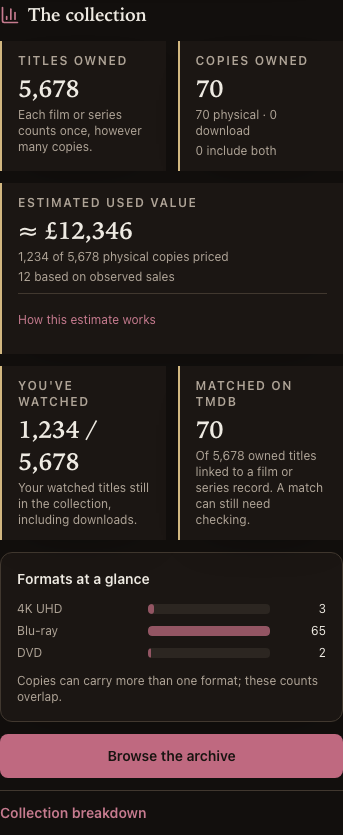
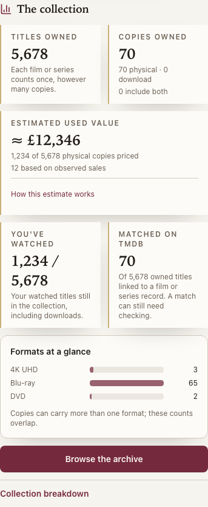

# AB2 verification — collection coverage and Summary cards

Review/build began 28 Oct; shipped 29 Oct. Sitting 1 only. Owner picks and exact additive contract were approved in chat
before build plan/code; decision #303 records the scoped supersession of #299.
Clean starting main 86e7d56 passed all seven CI jobs (40759704615). The existing review
commit c2a6784 is preserved on the branch; implementation commit is 8e61dd6.

## How it works

Signed-in person → distinct active watched titles ∩ currently owned titles →
ownedWatchedMovies / totalMovies → Home Summary cards.

The API always emits a non-negative ownedWatchedMovies integer on the existing stats
endpoint; watchedMovies remains the whole-diary distinct count. No diary mutation,
new endpoint/request parameter, migration, paid service or price algorithm change.
The shared reader accepts an absent new field from an older API/cached response without
a default; Home shows Unavailable with the approved saved-response explanation.

Current ownership is the existing owned_film predicate: downloads and listed-for-sale
copies count; sold/donated/trashed copies do not; an extra remaining copy retains a title.
Rewatches/extra copies count once. A deleted film or deleted watch cannot add coverage.
The profile id now scopes Home's stats query, preventing another person's cached numerator
from appearing after account switching. Successful mutations and manual/automatic replay
invalidate stats: inspection found the former watch/copy paths had left a five-minute cache.
This is an implementation decision inside the approved refresh/ownership scope, not a
new account permission or authentication policy.

The approved Summary cards retain five figures and Archive navigation in every async state.
Short descriptions distinguish titles, copies, overlap, current personal coverage and TMDB
matching. Existing value coverage and full valuation caveats remain. A format-bar preview
is visible before disclosure; the full format/location/genre/decade/recorded-spend charts and
missing-price/date explanations remain. Other Home shelves retain their sideways layout.

## Acceptance evidence

| Criterion | Evidence | Outcome |
|---|---|---|
| Owner picks before build | Review alternatives/screenshots, chat approval, #303, separate build plan before code | Pass |
| Distinct currently owned personal coverage | Disposable Postgres: download, multiple copies/rewatches, other person, deleted film/watch, sold/donated/Trash, last copy departure/restoration | Pass |
| Diary/account privacy | Whole-diary query unchanged; independent two-profile assertions and ignored other-user parameter; E2E real same-browser sign-out/in | Pass |
| Exact additive contract/older answers | Pydantic required integer; OpenAPI exact snapshot; shared nonnegative/integer validation; genuine zero and absent-field unit/browser cases | Pass |
| Approved presentation and existing meanings | Both people/both themes 375 px/desktop, 320 px overflow, exact current numerator/denominator, visible preview/full charts and Archive width | Pass |
| Refresh after real changes | Browser watch mutation returns to previously cached Home with new numerator; API rewatch/copy sale/listing/return/watch removal; central mutation and replay invalidation | Pass |
| Full verification and production readback | Exact-head PR/main CI, SHA/full readiness and read-only live comparison below | Pass |

Existing AA3 browser assertions were updated only for the approved copy label and watched
meaning; the old cases remain. New assertions extend coverage. No route/access inventory,
API auth assertion, gate, retry, skip, ignore or suppression was weakened.

## Checks and failures

Focused API/stat/OpenAPI: 26 passed on disposable loopback Postgres, zero skips.
Focused web/dashboard/query-client/contract: 29 passed. Shared: 158 passed.
The corrected focused Chromium run passed all seven cases (existing AA3 plus AB2 journeys).
React best-practices review covered the touched TSX components: hooks remain unconditional,
derived display stays in render, person-specific query keys isolate the count, no new
chart dependency or waterfall, and semantic lists/disclosures retain keyboard access.

Failures and repairs, including first-attempt failures:

- New E2E optional-field fixture used an intersection that still made the property required;
  TypeScript rejected deletion. Used Omit plus an optional field; E2E typecheck passed.
- Initial phone E2E cases searched for the desktop combobox. They now open the visible
  mobile Search sheet, retaining the cache-sensitive client-side navigation assertion.
- The same-browser test assumed sign-in always lands on Home. Login correctly returned to
  You; the test checks Mark's account then taps Home without reloading the app.
- Review corrected the listing fixture to the real existing status request field and
  compares only the three stats counters during rewatch (the real mostWatched ranking
  intentionally changes). No product response or acceptance assertion was loosened.
- Neon did not honour the probe's default transaction read-only startup setting. A SHOW
  assertion stopped that attempt before catalogue reads. The probe now explicitly sets
  the transaction READ ONLY and confirms it, then uses a local statement timeout.
  The corrected live read passed; no live data/provider/model write or request occurred.

## Read-only live comparison

Before deployment, the implemented handler on current live rows agrees with an independent
SQL intersection: Craig 482 / 1,903 owned versus 500 diary; Mark 878 / 1,903 versus 879.
These are observations, not pinned test expectations. The intersection query executed in
2.9/2.7 ms with 1.4/1.8 ms planning; these are database statement times, not HTTP latency.

The readback invokes the exact checked-out application's actual stats handler inside a
confirmed read-only transaction. It is not a production authenticated HTTP/browser session.
The full fixture-backed E2E suite proves browser → real API → real Postgres behaviour.
No synthetic production login, live collection/history write, price refresh, external
provider/model call, hosting/credential change or notification was used.

## Final gates and deployment

All ten batch-verify checks passed from clean 8e61dd6 and left it clean: API 2,523 with
zero skips (all 16 derived-trigger cases), shared 158, web 732. Lint/format/mypy, both
TypeScript checks and both builds passed. Web lint retains 11 existing Fast Refresh
warnings; API emitted 30 existing warnings, with no new suppression. E2E typecheck passed.
Complete local E2E: Chromium 54 passed; Firefox 53 passed plus its existing documented
no-dictation skip; cron six passed. No new skip or retry. All provider/model calls in this
suite use the outside-world fakes against disposable loopback-only Postgres.
PR #119: https://github.com/CraigR973/mcu-app/pull/119, exact head 497d01d.
PR CI 40790276329 and merge CI 40791938628 passed all seven jobs. Merge: `c187ed7d5f5a9f904c19440664b2ab98d7c35c9c`.
The application/shared/migration/test tree is identical to clean local gate 8e61dd6;
497d01d adds only verification/review documentation and screenshots.
CI E2E: Chromium 54, Firefox 53 plus its one existing skip, WebKit 52 plus its two
existing documented skips, cron six. No new skip/retry. All five new AB2 cases passed
in every CI browser. API and web served the exact merged SHA with db ready and all
push/AI/eBay/TMDB/Brave flags configured. Unauthenticated stats remained 401.
Read-only live handler comparison repeated from the merge matches the independent SQL
for both people; their whole-diary counts remain unchanged. Local WebKit is unavailable on macOS 13 and must be proved by CI.
Real-phone observations and AA10b's final-total checkpoint remain owner-only; AB2 cannot
claim those passed. Sitting 2 and AA10c remain outside this run.

## Phone-size evidence

Actual app, fixture-backed Chromium, 375 px: both people and both themes were checked,
including expanded charts and the Archive action. The two images below deliberately stress
four-digit coverage/value text; their overridden figures are layout fixtures, not a
consistent catalogue snapshot or live-value evidence.

## Close-out — 29 Oct

AB2 shipped as `c187ed7d5f5a9f904c19440664b2ab98d7c35c9c` in PR #119. AB1 and AB2 complete Group AB sitting 1;
planning PR #117's approved commits remain in normal reviewed/CI-tested history.
The ledger, architecture reconciliation/map, owner actions, grouping status and session
handoff are updated. Closing documentation changes no application/shared/migration/test
source; its exact-head CI and API/web readback are checked again before the session ends.
Sitting 2 and AA10c are not started. AA10b final-total and existing real-phone/live-assistant
owner observations remain open independently.

Workflow repair: this gh version has no `pr diff --stat` flag; reviewed the actual PR patch
with `gh pr diff` and the summary with `git diff --stat`. No gate/product change.
