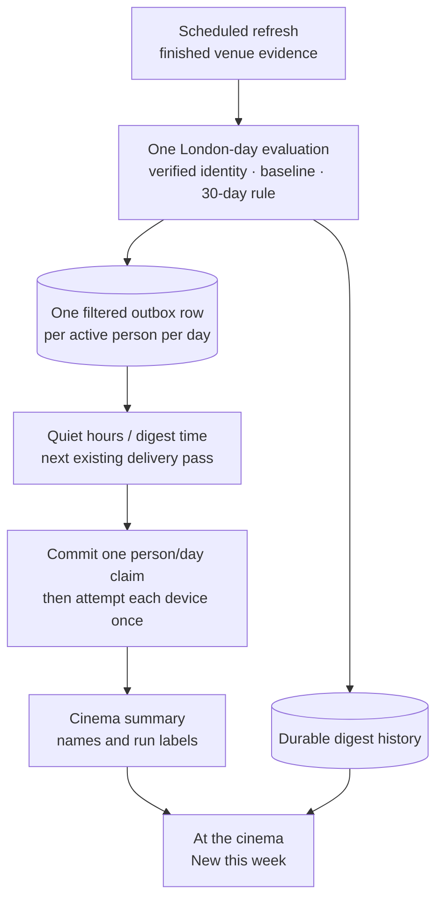

# AC6 — Daily cinema digest: owner checkpoint

7 Nov. **Proposal only; build approval is pending.** Scope: AC6 alone, the remaining batch
in Group AC sitting 4. Craig approved using this session's current model after the requested
GPT-5.6 Sol High / Opus 5.5 high was unavailable (reply: “approve”). That answer approved
the model substitution only. None of the recommendations below is approved yet.

## What Craig needs to decide

The digest can reuse the existing refresh and outbox, but three choices change the apparent
promise: absence is observed rather than proved, a held push can arrive the following day,
and strict duplicate prevention can lose a push after a crash. Cinema digests also need
their own payload in digest mode to retain film names, run labels and their destination.

1. **Approve the two preferences and migration in §2.** Recommended: Cinemas on, Older films
   only off, for existing and future profiles. Cost: migration 073, five small durable tables,
   two preference columns and additive API/shared schemas. Default-on means existing people
   start receiving qualifying future digests without opting in. A migration failure blocks
   the API deploy; downgrade refuses to discard populated digest history.
2. **Start silently from the existing programme (§3).** Recommended: seed its identities and
   unresolved listings as already known; no launch-day catch-up push. Reject notifying the
   whole current programme: most of it is not newly listed. Cost: existing films, including
   ones matched later from the current backlog, stay silent until a qualifying return.
3. **Wait for AC3 identity, never merge on title (§4).** Recommended: notify a new listing
   once matched while it still has a showing, deduplicated across the nine. Cost: unmatched
   films can be late or never notified; delayed matching is labelled on the destination.
   An identity correction alone never creates another notification.
4. **Define a return as 30 consecutive successfully observed absent days (§5).** Recommended
   for the programme these sources actually expose. A failed, disabled or unobserved venue
   breaks the absence count; incomplete but successfully observed source pages may count.
   Cost/risk: this is absence from the observed programme, not proof a venue had no other
   listing. Eight venues presently provide no completeness guarantee. Requiring complete
   absence evidence would currently prevent returns from qualifying. This interpretation
   needs Craig's express approval; it must not silently narrow or replace the ledger.
5. **Freeze one daily result after the first finished usable scheduled refresh (§6).**
   Recommended: successful venues may contribute even when other venues fail; failed venues
   add nothing. Same-day retries cannot create another digest. Cost: a later recovery or
   newly added film waits until the next scheduled day's evaluation. A completely failed
   refresh freezes nothing and queues nothing.
6. **Keep the existing schedules (§7).** Recommended: deliver immediately after refreshing
   when allowed; otherwise use the existing delivery passes. Cost: the digest hour is an
   earliest time, not an appointment; a 09:00 hold can wait until the next day's pass. No new
   provider fee or hosting change; existing compute/storage usage is unpriced. Reject a new
   frequent delivery cron for AC6: it needs a separate hosting decision and measured cost.
7. **Prefer no duplicate send attempt over guaranteed receipt (§8).** Recommended: durably
   claim one cinema delivery per person per London day before transport, then never replay
   an uncertain attempt. Cost: a crash between claiming and sending can lose that day's push;
   this requires a cinema-specific delivery path. Each active device still receives the
   same logical digest. Digest mode delays this cinema summary but sends it separately from
   the collection summary: potentially two summaries, rather than the present “one summary”
   promise. Reject using the unmodified mixed digest: it drops film bodies and opens
   Notifications. Reject resending after an uncertain network outcome: it can duplicate.
8. **Approve all wording and the New this week destination (§9), with the verification
   boundary in §10.** Recommended: explicit run labels, no empty push, a rolling seven-day
   section reached directly from the push. Cost: an additive programme response and browser
   work, full gate/E2E/PR/deploy, then waiting for a genuine scheduled digest. Phone receipt
   remains Craig's observation. No manual production refresh or test digest.

Reply “Approve all 8”, or give changes by number. An answer will be recorded before code is
written. If any recommendation changes, the contract will be revised before implementation.

## 1. Evidence checked on 7 Nov

The checkout began clean on main at `746b23027fc79223ffbc5405e0a2186cca91a265`. After fetching,
origin/main was the same. [CI 42379182157](https://github.com/CraigR973/mcu-app/actions/runs/42379182157)
passed all seven jobs, including E2E. Production API health and web version both returned
that full SHA; readiness returned db ok and push, AI, eBay, TMDB and Brave configured.

Live aggregate reads ran in an explicitly read-only Postgres transaction: migration 072;
9 enabled venues; 2 active profiles; 2 preference rows, neither using digest mode or quiet
hours; 1,486 future confirmed showings, 1,111 linked showings covering 22 distinct TMDB film
IDs, and 0 older-film showings. These are a point-in-time observation, never a two-profile
implementation assumption. AC3's requested rerun read-back after 8 Nov remains separate.

The latest run was 7 Nov, 08:03–08:05 UTC, partial. All nine venue collections reported
`failed=false`; only Vue reported complete dates (7–8 Nov). The other eight had observed
dates but no complete dates. A partial run therefore cannot simply be rejected wholesale,
and missing rows cannot be treated as proven absence.

Source inspection:

- `cinemas.refresh.exclusive` uses a dedicated Postgres advisory lock and a fenced lease.
  Each venue commits separately; final run status commits afterwards. A run can therefore
  leave some committed venues and still fail overall.
- AC3 stores verified identity in cinema-film evidence; AC4 groups linked films by identity.
  Run labels belong to showings: First run, Preview, Rerun or Unclassified. A rerun is not
  the same thing as a film returning to these nine programmes after a gap.
- The morning job delivers reminders before refreshing cinemas. AC6 needs an additional
  post-refresh queue/delivery stage; reordering the trip reminder stage is unnecessary.
- The outbox has unique dedupe keys and locked delivery claims within the sending transaction.
  A process crash after transport but before commit can still leave a row queued. A database
  transaction does not make the external push and its commit atomic.
- Digest mode currently combines due rows into a collection summary containing their titles
  but not their bodies, opening `/notifications`. Quiet hours and digest hour calculate an
  earliest delivery time. No dedicated frequent notification delivery schedule exists.

No application code, schema, hosting, source collection or production data was changed while
preparing this checkpoint. The first attempt to use `live_sql` found NEON_READONLY_URL unset;
the aggregate read instead used the existing local connection inside a read-only transaction.
No credential was printed. No local implementation gate was run: this is a documentation
checkpoint, not a verified build. Initial guessed file locations were corrected by source
discovery; none was edited or created to satisfy a guess.

## 2. Preferences, contracts and migration 073

`notification_preferences` gains two non-null booleans, both with Python and database defaults:

| Database column / JSON field | Default and meaning |
|---|---|
| `cinemas_enabled` / `cinemasEnabled` | true; daily cinema-film summary |
| `cinemas_older_only` / `cinemasOlderOnly` | false; when true, only verified Rerun showings qualify |

GET preferences returns both. PUT accepts either independently as optional fields; omission
preserves existing values. Turning Cinemas off retains the older-only choice. The child
control is visible but disabled while Cinemas is off. Each person edits only their preferences.
Future profiles get the same defaults through the existing lazy, race-safe preference creation.

Shared zod treats the new fields as optional for a cached answer or older API. The new controls
then read “Cinema notification settings are not available yet. Reload when connected.” and are
disabled; absence must not be presented as a saved on/off choice. A current API returns both.
No Movie night preference or trip behaviour changes.

The notifications category CHECK and category vocabulary gain `cinemas`. Existing categories,
including attention and collection additions, remain. Existing outbox statuses stay queued,
sent, suppressed and failed; cinema-specific explanations are reason strings and audit data.

Five tables provide history that the current 30-day screening and 90-day run retention cannot:

| Table | Exact proposed contents and constraints |
|---|---|
| `cinema_digest_films` | UUID id; unique positive integer `tmdb_id`; `first_observed_utc`; nullable `last_present_day`, `absent_since_day`, `absence_checked_through_day`; non-null `episode_number` default 0; `baseline` default false. Dates are London dates; an absence range has both endpoints or neither, in order. |
| `cinema_digest_listings` | UUID id; `source` varchar(40), `source_key` varchar(300), `source_fingerprint` varchar(64); nullable `film_id` FK to digest films, restrict delete; nullable `cinema_film_id` FK to cinema films, set null on delete; `first_observed_utc`, `last_observed_utc`; `baseline` default false. Unique source/key/fingerprint; index each FK. Survives cinema-film retention. |
| `cinema_digest_appearances` | UUID id; `film_id` FK to digest films, restrict delete; positive `episode_number`; `first_listing_utc`, `recognised_utc`; nullable source `run_id` FK, set null on delete; `title` varchar(500); `run_labels` JSONB array; `run_reasons` JSONB array; `is_return` boolean. Unique film/episode; indexes film, run and recognised time. These are qualifying episodes, not one row per showing. |
| `cinema_digest_days` | UUID id; unique `local_date`; nullable `run_id` FK, set null on delete; `evaluated_at_utc`; `report` JSONB object with successful/failed venue IDs, appearance IDs and each active recipient's result/notification ID. Inserted only with the completed evaluation transaction. No standalone in-progress day marker that can strand a retry. |
| `cinema_digest_deliveries` | UUID id; `user_id` FK to profiles, cascade delete; `local_date`; `claimed_at_utc`; nullable `finished_at_utc`; `notification_ids`, `appearance_ids`, `device_ids` JSONB arrays; immutable `payload` JSONB object; `outcome` in claimed/sent/failed/unknown; non-negative `delivered_count` default 0. Unique user/date; index user. Contains device UUIDs, never endpoints or keys. |

Every table also has `created_at_utc`, naive UTC, with the migration's frozen UTC default.
All JSONB container types and outcome vocabulary are CHECK-constrained; all required fields
are non-null. No table stores credentials. Persistent digest identities and appearance/day
history are not swept by cinema programme retention; storage grows with films, qualifying
episodes and scheduled days, not showings. No AC6 history purge is authorised here.

The migration seeds baseline identities/listings from the existing stored programme, including
unresolved listings, but creates no notifications, appearances or delivery claims. It changes
no existing film identity, showing, trip, catalogue or watch history. Current and historical
stored listings are treated as already known; pre-rollout absence is not reconstructed.

Guarded grants in the same migration block give mcu_readonly and mcu_backup SELECT on the two
new preference columns and all five new tables if those roles exist. No broader profiles or
push-subscription grants. Validate withheld credentials through privilege catalogues, never by
selecting secrets. The backup inventory must include the new readable tables.

Downgrade refuses if an appearance, evaluated day, delivery claim or cinemas notification
exists, or a preference differs from its rollout default. Otherwise it reverses baseline
seeding, removes the five new tables and two columns, and restores the original category
CHECK. CI proves upgrade/downgrade on a disposable database; discarding real history would
need a separate owner decision, not automatic deletion. Populated refusal has its own test.

## 3. Initial rollout and existing data

Migration 073's baseline is the launch boundary. The first scheduled refresh may notify only
new eligible listings observed after that boundary. Existing listings that acquire an AC3
identity tomorrow retain their baseline flag and do not become a launch backlog push.
If a baseline listing links to a film newly seen under another title, the identity is treated
as known across venues. A new format, time, source key or cinema alone never makes a known
film new again. No manual warm-up refresh and no notification generated during deployment.

The baseline is deliberately conservative: a film in retained history cannot be called new
merely because the older screening was deleted. A return requires the observed gap below.

## 4. Identity, labels and first appearance

Only AC3-verified TMDB film identities qualify. Source events, double bills, ambiguous matches,
conflicts and unverified listings do not push. Use AC3's verified evidence, never a title-only
join, a guessed year or an unrelated catalogue identity. One identity produces one episode
across all nine venues. Existing verified rows without a usable TMDB ID stay silent until
AC3 supplies one; they are not guessed into a global identity.

A new non-baseline listing without an identity is remembered but not notified. Once matched,
it may produce its first episode on a scheduled refresh while a qualifying showing remains.
Store both first-listing time and recognition time; if matching was delayed, show “First listed
3 Nov · Matched 7 Nov”, using the actual dates. Changing a reviewed identity suppresses a
fresh episode for that correction; it does not recycle an earlier push under a new key.

Qualifying positive evidence is a non-deleted, future, confirmed, non-expired showing observed
and promoted by a successful venue in this finished run. A venue's failed snapshot, rows
retained from an earlier run, or unconfirmed/withdrawn/cancelled showings create no episode.
Older retained or unconfirmed future rows may still block an absence claim conservatively.

Use the showing's existing run evidence, including Preview. Distinct applicable labels appear
in this order: Preview, First run, Rerun, Unclassified. A general digest may name an identified
film whose run is Unclassified. Older films only requires at least one qualifying Rerun
showing and names only its Rerun classification; it never infers “older” from a title or a
missing release date. A changed run label alone is not another appearance.

## 5. Return after 30 days

“New” concerns this observed nine-venue programme, not the film's release date or a person's
watch history. A first-run film can return; a rerun can appear for the first time here.

For an already known identity, begin an absence range on the first London date when all nine
enabled venues collected successfully and the stored forward programme has no remaining
showing for it. Do not count an elapsed day before its last known showing; retain current
unconfirmed future rows as possible presence. Each subsequent London date must satisfy the
same observation rule. A missing daily run, failed/disabled venue or missing observation
resets the range. Re-running one date cannot add another absent day.

A positive return qualifies if the preceding absent range contains at least 30 consecutive
London dates, ending yesterday or later. For example, absent on 8 Nov through 7 Dec inclusive
permits a return first observed on 8 Dec; a return on 7 Dec has only 29 days and stays silent.
A future booking already listed anywhere stops the gap, even if its screening is later.

Successfully observed partial pages count under recommendation 4; complete coverage is not
asserted. Failed venues never prove absence. This choice makes the criterion operational
with today's sources but can misclassify a return if an incomplete source hid a listing for
30 days. Rejecting that risk requires revising the return requirement or obtaining stronger
source coverage in separately authorised work. Do not present tests as proof of live completeness.

## 6. Failed, partial, retried and overlapping runs

The daily evaluator runs inside the existing exclusive refresh scope, after venue promotion
and final healthy/partial status commit. It also takes a transaction lock dedicated to digest
evaluation; database uniqueness is the final arbiter. It accepts scheduled (`cron`) runs only.
A failed, abandoned, lease-lost or unfinished run cannot queue a digest even if a venue
transaction had committed before it failed.

The first terminal scheduled run with at least one successfully observed venue on a London
date gets one atomic evaluation: update listing/identity history, create qualifying episodes,
queue each active person's filtered outbox row and insert that date's result. The dedupe key
is `cinemas:<profile UUID>:<London YYYY-MM-DD>`. A disabled switch leaves an auditable suppressed
row when there are candidates; no matching candidates means no outbox row and no push.
No fixed profile IDs, roles or two-person loops.

Rollback leaves none of this evaluation committed; retry may repeat it. Commit makes retries
read the frozen daily result. A later same-day refresh may still update programmes normally,
but cannot advance digest history or queue another digest. Newly recovered evidence is
considered on the next scheduled day. Empty successful days are recorded, preventing a later
same-day rerun from turning them into another evaluation. All-venue failure records no evaluated
day, so a genuine later scheduled recovery may still evaluate that day.

A crash after the run's final commit but before evaluation is recovered from that day's
finished cron run and its persisted venue report/current run-linked rows before another refresh
can overwrite those observations. No source refetch is needed for recovery. If recovery is
already a later London day, record the missed evaluation, do not manufacture a historical
push, and evaluate the current scheduled day; the broken absence streak stays broken.
Persist per-venue outcomes and require their coverage/run provenance, never “latest rows” alone.

## 7. Quiet hours, digest mode and delayed delivery

Add a post-refresh queue/delivery stage to the existing morning command. Its failure cannot
roll back reminders, cinema trips or committed programmes, and its result is logged separately.
`--no-deliver` must suppress this stage's transport as well. Any recovery helper evaluates
stored evidence only; it never starts a live refresh to manufacture acceptance.

The Cinemas switch and older-only filter apply at creation and are checked again before an
unclaimed cinema send. Switching off cancels pending cinema delivery. Narrowing to older-only
removes ineligible titles; no surviving title means a recorded suppression. Switching on or
broadening a filter does not backfill episodes previously excluded for that person.

Apply existing timezone-aware `scheduled_delivery`: digest hour first, then quiet hours.
Delivery cannot occur before that target, or during currently applicable quiet hours. Recheck
quiet hours when claiming rather than allowing a late pass to send during a new quiet period.

No timing guarantee is added. After 08:05 UTC, default 09:00-local digest mode waits for an
existing subsequent delivery pass: the 03:00 UTC scrape and 08:00 UTC reminders are scheduled
delivery opportunities; some user actions and eBay alert passes can also deliver, but those
are not dependable timers. A due cinema summary may therefore wait until the following day.
Even 03:00 delivery waits if quiet hours cover it. Neither person's current live preferences
uses a hold, but the implementation must support future settings.

Cinema messages are excluded from the generic collection-summary bundling. In digest mode
they wait for the same selected time but retain their own single payload and destination.
The Daily digest description changes exactly as §9 says; other categories, including Movie
night trips, keep their present grouping and behaviour. This is an explicit exception to
“one summary”, not a claim that the current mixed summary meets AC6.

## 8. At most one send, including crash recovery

The promise is one logical cinema summary per person per Europe/London calendar date,
fanned out once to each currently active registered device. Several phones are still several
physical pushes. There is one queued digest per evaluation day and at most one claimed
cinema delivery per actual delivery day, so two delayed daily rows cannot buzz twice today.

Before transport, collect all due, unclaimed cinema rows for that person. Merge their unique
appearance IDs into one payload, filter against current preferences and current remaining
showings, and exclude appearances recognised more than seven days ago. Record obsolete
rows as suppressed (`cinema_digest_expired`, `cinema_filter_empty` or `category_disabled`);
record absorbed rows as `cinema_digest_coalesced`. Their original titles and daily result
remain auditable. If nothing survives, make no delivery claim and send nothing.

Lock/uniquely insert the person/day delivery claim and commit its payload, outbox IDs,
appearance IDs and active device UUIDs before any network send. A competing sender that
finds the claim cannot send again. A fresh eligible digest due later on an already claimed
day remains queued for a later day and can coalesce then. Generic delivery must exclude
cinemas at every call site; the AC6 dispatcher runs only on committed outbox rows using
independent sessions. It must not commit a caller's unrelated transaction.

The dispatcher makes at most one HTTP send attempt to each listed device, with no automatic
transport retry. Success/failure is recorded afterwards. A crash or lost answer leaves an
uncertain claim; recovery records unknown/failed and does not replay it. Outbox text reads
“Delivery uncertain — not retried” when that is all we know, never Sent. If at least one
device was accepted, record the accepted-device count as today; device failures remain
visible in the claim. No subscriptions produces the existing no-subscriptions suppression.

This prevents application retries and overlapping workers from repeating a cinema push.
It cannot guarantee what an external push service or a phone displays. The cost of strict
at-most-once attempts is possible non-delivery, including a crash before the first HTTP call.
Exactly-once phone receipt is not a promise this system can honestly make.

## 9. Exact words and destination

| Place | Proposed text |
|---|---|
| Category switch | **Cinemas** |
| Category description | “One daily summary of films newly listed at your nine cinemas. No new films means no notification.” |
| Child switch | “Older films only” |
| Child description | “Only films with a confirmed Rerun showing. First runs, previews and unclassified runs stay quiet.” |
| Daily digest description | “Hold notifications until your digest time. Cinema updates arrive as their own daily summary; other updates are grouped together.” |
| Timing help | “Delivery waits for the next notification check after this time; it may arrive the following day.” |
| General push title | “1 film newly listed at your cinemas” / “{n} films newly listed at your cinemas” |
| Older-only push title | “1 older film newly listed at your cinemas” / “{n} older films newly listed at your cinemas” |
| Push body | One line per film: “{title} — {run labels}”; a return adds “ · Back in the programme”. First three films; then “And {n} more. Open New this week.” |
| New section | “New this week” |
| Section description | “New programme arrivals and returns after 30 days, added here in the past seven days. Delayed matches show when they were first listed.” |
| Empty, all films | “No new films at your cinemas this week.” |
| Empty, older only | “No newly listed older films this week.” |
| Empty help | “New films appear after the daily programme check. Unmatched listings and incomplete programmes may hold other films.” |
| Historical entry without a future time | “No remaining showings in the saved programme.” |

Titles are bounded on Unicode character boundaries and body UTF-8 bytes are bounded so the
complete encrypted payload fits the existing push implementation. If a long title exhausts
the budget, include fewer titles and the exact remaining count; full titles remain in the
view and outbox. Never truncate JSON bytes or drop the run label to squeeze in another film.
Examples above are wording examples, not production pushes.

Push destination: `/movie-night/cinema?view=new-this-week`, adding `&run=olderFilm` for an
older-only digest. New this week is a distinct section/filter within At the cinema, not the
existing New releases filter. It shows qualifying appearances recognised in the past seven
days, newest first, one card per identity, with run badges, first-listed date when recognition
was delayed, and a Back in the programme badge for returns. An entry that no longer has a
time stays as a historical card with the wording above; ticket actions still obey AB7/AC4.

`GET /api/v1/cinemas/films` gains optional `newThisWeek`, containing the cards and their
appearance/recognition/first-listing metadata, with shared zod parsing. It is read-only and
does not filter the existing programme or generate notifications. The query parameter and
existing run/day/cinema filters survive navigation. “All films” leaves the new-only view.
The normal programme remains available whether the push switch is on or off. With an old
cached/API answer, the section says “New this week is not available in this saved programme.
Reload when connected.” rather than falsely saying nothing is new. Offline reads use saved
data and keep the existing ticket guard. Sign-in preserves the app-relative destination.

Proposed flow, not the shipped architecture map:

## 10. Verification and acceptance boundary

After approval, record the answer and restate the ledger criteria verbatim before code.
Use this existing checkout and AC6 branch, one AC6 PR. No unrelated batch work or new worktree.
Recheck remote main/CI/deployment before implementation if the checkpoint waits.

Database tests use disposable local Postgres, never Neon. Cover existing and absent preference
rows, three or more profiles, both defaults, independent switches and guarded grants with
and without roles. Prove migration reversal on empty state and refusal with populated state;
verify all old categories and withheld credential privileges.

Exercise the real evaluator against duplicate identities at nine venues, alternate source
keys, baseline unresolved-to-linked rows, delayed matching, corrections, first appearances,
29/30-day boundaries, daylight-saving changes, short source horizons, missing days, failed
and partial venue collections, cancelled/withdrawn/expired showings and all-empty programmes.
Use independent database connections and a barrier to force overlapping evaluations and
delivery claims. Crash injection must cover each venue commit, final status, day transaction,
outbox commit, claim commit, first HTTP call and send-result commit. Retry and rollback must
prove exact notification, appearance and transport-call counts, not just success responses.

Delivery tests cover quiet hours and digest mode separately and together, late checks during
new quiet hours, switch/filter changes while pending, zero/two devices, one refused device,
uncertain outcomes, multiple delayed daily rows on one delivery date, payload byte bounds,
coalescing, expiry, no-send mode, and exclusion from every generic sender. Regression tests
preserve AC5's Movie night switch, invitations, replies, trip reminder timing and grouping.

Frontend/shared tests and E2E cover saving both controls, old API answers, both themes at
375 px, keyboard operation, loading/error/empty/offline states, seven-day history, direct
push destination through sign-in and film-page Back. Decrypt a fake push and assert names,
run labels and destination; exercise the scheduled command with fake source/TMDB/push data,
then run it again to prove no duplicate. No live provider is contacted by tests.

Run every batch-verify command plus the full E2E suite. API database tests run against
throwaway Postgres with no hidden database skips. Local WebKit is unavailable on this Mac;
report it and require the exact-commit CI WebKit job. Report all failures and only the
three documented browser-case skips. Do not weaken any expectation without reporting the
required change to Craig. PR/main CI must pass all seven jobs for the exact commit; API/web
must serve that SHA with every readiness field healthy.

After deployment, read migration 073, grants, default preferences, the seeded baseline and
credential privilege exclusions without creating a notification. Wait for the first genuine
scheduled digest; read its day/appearances/outbox/claim, eligibility and disposition. If the
scheduled run has no new eligible film, report no digest and keep positive delivery evidence
pending. Never manually send one or run a refresh to manufacture acceptance. An outbox Sent
row records push-service acceptance, not phone receipt. Craig observes the real phone and tap.

Do not mark full AC6 acceptance while scheduled-digest evidence is pending. The request's
post-deploy criterion necessarily places the first scheduled read-back after deployment:
after checkpoint approval, complete the code/local/exact-commit CI gates, deploy under the
request's shipment authority, and keep the ledger explicitly awaiting scheduled evidence.
Deployment is not full acceptance. Finish automatic close-out only when its conditions
actually hold, without treating an empty scheduled run as a positive digest observation.
AC3's post-8-Nov rerun check and AC5's first real trip/phone observations remain separate.
Stop after AC6.
