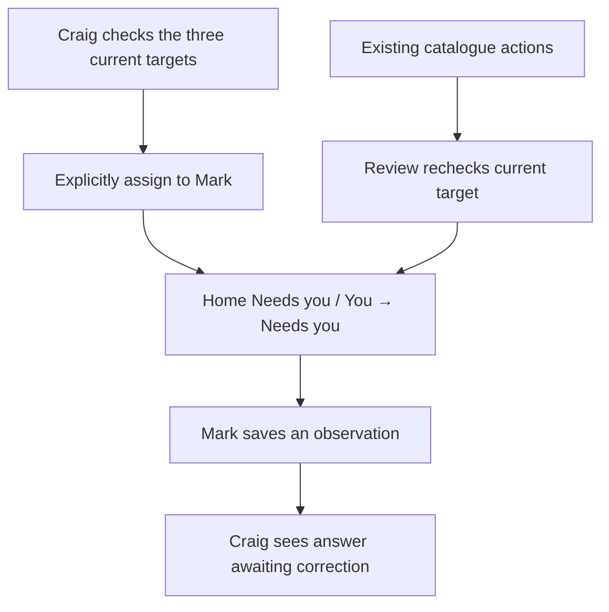

# Mark's three assigned review cards — AD1 — 8 Nov 2026

> **Follow-up complete 9 Nov:** the 36 px asynchronous movie-night insertion is proved
> and repaired. All runnable local checks pass; release remains unauthorised.
> See `ad1-navigation-follow-up-2026-11-08-2326.md`. The original timed failure evidence
> below is retained as history; it is superseded for current local verification.

## Current verdict

**Built locally; release blocked by one Firefox Add a copy navigation failure. Not deployed or assigned in production.**
Craig approved the three-card proposal in this chat. Optional grouped disc specs/phone
checks, Mark's Letterboxd enable and historical imports remain excluded. The earlier
explicit no-commit/push/merge/deploy/live-write boundary is retained for this sitting.

## Starting point and preservation

The current checkout started on main `417471a167c4b1469a300cfe8124e5f7c1dbe39c`.
Remote main still matched; CI 42402887825 was successful and the newer Backup run was
also successful. Fresh API/web health reported the same SHA; readiness was `ready`,
`db: ok`, with push/AI/eBay/TMDB/Brave configured.

The implementation branch is `feat/ad1-mark-review-cards`, in the same checkout. Existing
edits to STATUS, OWNER-ACTIONS and the phase ledger were carried intact; no clean-tree
start is claimed. All five pre-existing untracked reports/proposals were retained.
No worktree, stash, discard or `cd`; no existing report was overwritten. A before-work
hash manifest is private in `/tmp/mcu-mark-reviews-preservation.json`.

Decision 351 and the AD1 ledger record the approved scope. This extends decision 336 for
explicit assigned reviews while retaining derived loan/trip jobs and existing roles.

## How it works

The three fixed questions cover Titanic's affected Blu-ray (1953/1997), Dead Man's Shoes
on Wanted (1940/2004) and Shetland Series 5's series identity, retaining separate copies.
There is no provider request or automatic catalogue repair on any review read/answer.

One new `assigned_reviews` table stores assignments, relevant target snapshots, revisions
and current answers. Audit entries retain creation, answers and reassignment history.
Uncertainty stays open; an answer alone remains “Answered — awaiting correction”. A
changed/missing/sold target blocks a new answer. Existing settled doubts and the expected
Shetland series identity are recognised from source records; a changed Wanted identity is
not treated as proof of corrected price-history association. Deleted/merged catalogue
targets cannot silently erase review history or block established correction paths.

The additive API/shared zod `reviews` field preserves old clients and cached answers.
Home retains five rows and existing trip/loan priority, with review overflow to a complete
review page. You links to that page. A selected review scrolls into view. Craig sees all
responses and an explicit three-target check/assignment action; Mark can answer only his
own reviews. Administrator status does not permit answering for him. No role promotion,
admin spec-queue access, new notification, scheduler, hosting or credential work.

The migration creates no assignments. Its guarded grants cover read-only/backup roles;
its downgrade refuses while review history exists. Actual production assignment is an
explicit administrator action after an authorised release, not a Home read or migration.
Three assignments are sequential: a partial failure is shown, and repeated unchanged
assignments preserve records and answers rather than creating duplicates.

## Exact production targets checked read-only

Read-only established live SQL confirmed Titanic has one affected Blu-ray copy
`a5b932de-a679-49b3-bfba-2e9c30ef1e5d`, named by open doubt
`66d4862e-09a6-4b60-95ef-eb0e013ae6db`. Its separate download is not the review target.
Shetland Series 5 has one owned DVD copy `5235685a-ebad-4af4-9015-6eb4558f2f93`.
The known wanted-film target is included in the approved manifest. Assignment preflight
revalidates all targets and refuses ambiguous counts or changed original identities.
No identity was inferred or repaired, no credential printed, and no provider contacted.

## Acceptance checklist — as recorded before implementation

1. Mark sees the three exact reviews; another viewer sees none of them.
2. Craig can inspect responses; forged cross-profile reads/writes fail.
3. Uncertainty stays open; answering does not repair catalogue identities.
4. Stale targets do not permit silent corrections; existing authorised resolutions are recognised.
5. Overflow exposes every task; normal loan/trip behaviour remains intact.
6. Assignment is idempotent, answers are revision-guarded and audited, and review history is preserved.
7. Migration/grants, full local gate and role-aware browser flows pass; unrun CI/deploy/phone gates stay explicit.

Final local evidence and the unresolved release blocker are recorded below.

## Verification history — retained failures

- Fresh disposable Postgres migration passes upgrade head → downgrade base → upgrade head.
  A populated downgrade is separately covered by a refusal test; grants/withheld PIN
  privileges are checked through the catalogue, not by selecting credentials.
- First focused API run: 22 passed. New tests cover private reads/writes, no administrator
  answering by proxy, uncertainty, exact choices, idempotent retry, stale revisions and
  targets, source resolutions, reassignment/history and ambiguous manifests. Further
  coverage includes deleted-target links, genuine concurrent observations and migration
  guards. Final candidate results are recorded below.
- Static API lint/format and mypy passed in the initial checks. Web lint reported 0 errors,
  11 existing warnings. Shared tests passed 200 in the first full JS attempt. Final results after the latest changes are recorded below.
- Initial focused frontend tests failed: the new page omitted the established happy-dom
  directive and new assertions used jest-dom matchers absent from this repo. Corrected
  the harness/matcher usage without changing the intended assertions. A subsequent exact
  text expectation missed its visible assignee prefix; the expectation now asserts the
  complete displayed sentence, rather than weakening it to a substring.
- Initial disposable Postgres bootstrap failed on the inherited unsupported locale;
  explicit `LC_ALL=C LANG=C` fixed it. The reversal helper initially attempted CREATE
  DATABASE within a psycopg transaction context; opening its local autocommit connection
  outside that context fixed the harness. The reversal then passed.
- The first full API run was interrupted after 192 passes to reduce overlapping work on
  a heavily contended Mac; it is not a complete gate. Observed load averages reached
  264–286. Four existing UI cases failed in the overlapping full JS run; their exact
  findings are retained for diagnosis, not silently retried or reclassified as passes.
- The first focused browser attempt failed before running the test because its disposable
  API did not become ready within the unchanged 60-second harness gate. The API log had
  no new startup output at that point. No timeout, assertion or skip was changed.

### Diagnosed gate failures and corrections

The first overlapping full JS attempt finished with **200 shared passed; 891 web passed,
6 web failed**. Four unchanged UI cases were waiting on rendering under severe contention;
the new page had one exact-text expectation missing its assignee prefix; the API contract
check correctly rejected four frontend calls absent from the not-yet-regenerated OpenAPI
snapshot. Regenerated the snapshot from the actual app. With one worker and competing
runs finished, **all 86 focused UI/contract cases passed in 13.62 seconds**. Their original
assertions/timeouts were retained. That combined run had a non-fatal close-handle warning;
the new review-page file alone subsequently passed **5/5 in 2.62 seconds with the hanging
process reporter and no close warning**.

An isolated fake-world API import took **74.31 seconds** under the earlier load, explaining
why a new process could miss the unchanged browser harness's 60-second readiness gate.
Full gates now run sequentially; JS uses one worker rather than three, with the same cases
and timeouts. The application candidate is fingerprinted before each gate step.

The first completed serial API attempt found **16 failed / 2,657 passed / 9 skipped /
72 errors**. Its concurrency assertion itself produced the required **one 200 and one
409**; its fixture cleanup then failed because collection deletes are soft by default.
The failed cleanup transaction left a fake Titanic disc/review committed, contaminating
later global-count and scripted-provider fixtures. Fixed the fixture to use the existing
**transaction-scoped permanent-delete setting on its own disposable rows**, and added
explicit post-cleanup absence assertions. Applied the same atomic cleanup discipline to
the browser fixture. No production delete or global trigger change occurred. The other
intended contract failure was the exact route inventory: it now explicitly includes the
five approved review paths, retaining every previous path and the exact-set comparison.

The interrupted earlier backup fixture also left a local backup role without initial
schema grants on the original disposable database. A new empty gate database applies
all migrations with the test roles already present, proving the real guarded grants
rather than hand-granting around a failure. The original failed database/logs remain
for diagnosis. The new full run includes skip reasons; no skip is accepted as a pass.

The final application candidate now spans **26 files**, fingerprint
`31943154bd5b1df5feef4fa2636c93c6df0b4c42ed4605c4602fcb32becf494b`.
An unrelated `feedback-reconciliation-2026-11-08.md` appeared during the sitting; it is
preserved untouched and is not part of AD1 or its proposed release scope.

### No-skip API proof and visual integration correction

The clean socket-URL API run passed **2,745**, with **9 collection-replacement acceptance
cases skipped by their existing localhost-only safety guard**. The pnpm built-in `test`
command also rejected worker flags. Neither was accepted as a full gate: the dedicated
local test server was made available on loopback TCP, and `pnpm -r run test` forwards
worker flags to the same shared/web scripts. No guard, assertion or timeout changed.
The TCP run passed **all 2,754 API tests, zero skips**, in 193.03 seconds.

The first full browser run reached the new flow successfully, but **visual inspection
caught a real integration error**: the new page route omitted the standard signed-in app
shell. Its API remained caller-protected, but the page lacked app navigation and its
signed-out route guard. Stopped that run after 78 completed passes while case 79 was active;
its interruption marker is not a completed outcome. Preserved the pre-fix screenshot.
Wrapped the route in AppShell, registered its title/back destination, and strengthened
browser coverage to require the signed-out redirect and the visible app top bar for both
Craig and Mark. This is an in-scope repair, not a weaker assertion or bypass.

The final candidate is **28 application/test/contract files**, fingerprint
`daa142b39f31983f32eb4fd2ee1dd170d5199e7c0e6a5ef124e144abd45ce080`.
API/shared files are byte-identical to the no-skip API candidate. The updated frontend
again passes **200 shared / 898 web**, typechecks, lint and the production build. The final Chromium/Firefox/fake-job outcomes are recorded below.

### Incomplete cached browser seed — diagnosed and rebuilt

The post-shell Chromium attempt completed **91 passed / 4 failed**: Archive first-page
loading, import display, poster-action stability and shop alerts. Its snapshots showed
only **8 owned films**; the poster case could not find `Filler Feature 031`, and the shop
pass found **0 configured shops**. Source inspection established that the original
60-second startup failure occurred inside template construction, before its 62 filler
films and retailer setup. The existing harness reused the incomplete database merely
because it existed. This is a test-environment failure, not a reason to relax those cases.
Stopped the subsequent Firefox prefix and used the documented `E2E_RESEED=1` option.

The reseeded focused card flow passed. Read-only checks of both the template and its
post-test clone proved **70 owned films, 8 configured enabled shops and 0 leaked reviews**.
The same unchanged built candidate is now being tested against that complete seed.
**Chromium: 95/95 passed**, including every formerly failing case and the strengthened
new review flow. The final Firefox and job outcomes are recorded below.

A separate future harness improvement is to mark template completion or build atomically,
so a failed first build cannot be mistaken for a finished cached seed. No harness source
change or second implementation batch is included here; the established reseed option
is the bounded remedy for this verification.

The old whole-response assertion in the existing Needs you API test explicitly gained
`reviews: []`; all original fields/assertions remain. This is the approved additive contract,
not a relaxation. Existing local framework/deprecation warnings remain visible in logs.

## Final evidence and criterion verdicts

Final application candidate: **28 files**, fingerprint
`daa142b39f31983f32eb4fd2ee1dd170d5199e7c0e6a5ef124e144abd45ce080`.
API/shared files remain byte-identical to the no-skip API gate candidate.

| Check | Final result |
|---|---|
| API lint/format/mypy | Pass |
| API tests against real local Postgres | **2,754 passed, zero skips** |
| Shared/web tests | **200 / 898 passed** |
| Shared type/build; web lint/type/build; E2E types | Pass; 11 existing web lint warnings |
| Migration | Fresh head → base → head passes; populated downgrade refusal and both-role credential-safe grant tests pass |
| Chromium | **95 passed** |
| Firefox | **93 passed, 1 allowed dictation skip, 1 failure** |
| Fake jobs | **8 passed** |

Criteria **1–6 pass locally** through API tests and real-browser use of the new review flow.
They are not claims about production or Mark's actual observations. Criterion **7 remains
open** because the full Firefox suite is red. The same new review flow passes in Firefox;
the failure is in the existing Paper Lantern film page's first Add a copy click, before
any offline/replay operation. Normal click reports completion but no navigation occurs;
Search title never appears. The exact cause is unproved. No blind retry, force click,
assertion relaxation, timeout increase, added skip or unrelated repair was used.

The complete valid-seed run exited **1**. The preserved failure and next bounded scope are
`docs/reviews/ad1-firefox-add-copy-blocker-2026-11-08.md`. Keep AD1 unstruck and stop here.
Local proof does not satisfy the clean-tree/full-CI/production close-out prerequisites.

### Closing read-only production check — 15:26 GMT

- Current branch: `feat/ad1-mark-review-cards`; HEAD and remote main still
  `417471a167c4b1469a300cfe8124e5f7c1dbe39c`.
- Latest main code CI **42402887825**: completed successfully; all seven named jobs pass.
  This is the deployed baseline's CI, **not** CI for the uncommitted AD1 candidate.
- Production API and web both serve that exact baseline SHA.
- Every readiness field: `status: ready`, `db: ok`, `push: configured`, `ai: configured`,
  `ebay: configured`, `tmdb: configured`, `brave: configured`.
- Safe read-only SQL: production migration **073**, `assigned_reviews` **absent**. No live
  review assignments or answers were created by this sitting.

### Design choices within the approved contract

Durable explicit reviews are separate from derived loans/trips. Target IDs have no
catalogue foreign keys so an assignment cannot prevent a legitimate correction/delete;
reads instead detect changed/missing targets. Administrator assignment/inspection never
permits answering for Mark. Uncertainty stays open; an answer is not an identity repair.
Production assignment is an explicit reviewed action, with idempotent retry and no push.

### How to see it after an authorised release

Craig: **You → Needs you — assigned reviews → Check current targets → Assign these three
reviews to Mark**. The preflight refuses ambiguity/changed targets. Mark: **Home → Needs
you**, or the same You link, then inspect the film/copies and save an observation.
The screenshot above is local fake data, not Mark's response. No real-phone acceptance is
claimed. Mark's Letterboxd setup remains the separate prepared proposal; do not press
Sync now or import old diary entries under AD1 authority.

## Limits and next release checkpoint

No commit/CI for this uncommitted candidate, production migration, production assignment,
exact production candidate SHA, or real-phone observation is claimed. Current production
continues serving the pre-build SHA. Mark's separate setup proposal is ready but his
username/feed/import remains untouched. AC6 natural positive delivery and AA10c's 25 Nov
recorded-sales gate remain open.

Next: obtain Craig's go for the bounded Add a copy navigation diagnosis/repair in the
blocker report. Do not start it from AD1 authority. After that full gate passes, review
the exact candidate/preserved documentation scope and obtain release authority for the
commit, seven-job exact-SHA CI, deployment and three assignments. Do not absorb unrelated work or weaken a gate to ship.
