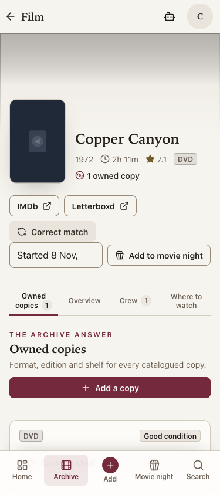

# Add a copy navigation follow-up — 8 Nov 2026, 23:26 UTC

## Current verdict

**Final result — 9 Nov, 00:02 UTC: all runnable local checks pass.** The cause is
proved and the bounded layout repair passes the deterministic pointer regressions and
the original unchanged offline case in the complete Chromium/Firefox runs. AD1 and the
repair remain uncommitted and unreleased. No production assignment or live write occurred.
The intentional preserved dirty checkout does not satisfy a clean-tree release gate;
exact-candidate CI/WebKit and release remain separate.

Craig approved this bounded follow-up after the blocker report; decision 352 records
that approval. It does not extend to Mark's feed, username, backfill or other batches.

## Confirmed cause and reproduction

The original full-run trace records GET `/api/v1/movie-night` at monotonic 492627.053 ms,
during the Add a copy click (492532.417–492673.124 ms). Its after-click DOM snapshot
newly inserts **Add to movie night** above the film tabs and Owned copies controls.
Those trace facts initially established correlation, not causation.

The controlled browser test then created one fake-world movie night, held the real local
GET response, pressed Add a copy with the normal mouse pointer and released the response
before pointer up. The unchanged implementation moved the link's layout position from
**419 to 455 px: 36 px**. Its bounding box moved from y=668 to y=705, including the
intentional 1 px active transform. The pointer-up missed the moved link and the film page
remained open. The deterministic geometry assertion failed. This reproduces the original
failure without offline mode, replay, a worker reload, provider access or production data.

The cause is asynchronous insertion of the movie-night action row, not a replay algorithm
failure. The existing film-page and offline-test files remain unchanged.

## Repair and design choices

The movie-night component now reserves a **44 px action row** during loading, empty,
error and populated initial states. Its selector and action remain on one row when several
nights are open, so their arrival cannot change the height. The selector can shrink on a
375 px screen; the native picker retains the full option labels. The closed selector
truncates date/time on that width, so opening it is needed to see the whole choice; the
real-phone picker is unverified. Existing suggestion
mutation, navigation, error handling, roles and API contracts are unchanged.

```text
Film heading and links
          │
Movie-night action row (44 px reserved)
          │
Film tabs and Add a copy (stable)
```

Design choices made within the approved repair:
- Keep 44 px reserved even when no night exists; this costs one blank action row.
- Keep multiple-night selection and the action on one row rather than introducing wrapping.
- Preserve the link, normal pointer interaction and all original route/content assertions.
- Add a controlled browser regression; do not wait for all movie nights before permitting the link.

The regression holds the real local response across pointer down/up, checks unchanged layout
position (excluding the existing active transform) and requires the real Search title tab.
It covers desktop 1280 px and narrow 375 px with multiple open nights.

## Verification evidence

- Before repair: controlled Firefox case fails at the exact 36 px layout displacement.
- After repair: both width cases pass; layout remains fixed and the add form opens.
- Both unchanged Firefox offline cases pass, including the original lost-answer replay case.
- Focused Firefox result: **4 passed**, 1.6 minutes, zero retries.

| Final runnable local check | Result |
|---|---|
| API lint/format/mypy | Pass |
| API suite, disposable Postgres 16.2 via pgserver | **2,754 passed, zero skips** |
| Shared/web suites, one worker each | **200 / 898 passed** |
| Shared type/build, web lint/type/build, browser-suite types | Pass; 11 existing web lint warnings |
| Full Chromium | **97 passed** (9.1 minutes) |
| Full Firefox | **96 passed, 1 existing allowed dictation skip** (10.6 minutes) |
| Fake jobs | **8 passed** (1.8 minutes) |

The full browser/job command exited **0** after 1,302.44 seconds. Every command in the
serial gate completed successfully. No assertion, timeout, skip or retry policy was weakened.
The API retains 36 warnings; the web build retains the existing Browserslist age notice.

- Migration reversal and populated-history refusal were already proved on the identical AD1
  migration/backend candidate in the prior sitting; this follow-up changes no migration or backend file.
- CI/WebKit for the uncommitted candidate, production release and real-device acceptance are unrun.

The first diagnostic harness attempt failed before any browser opened: API readiness did not
arrive within the unchanged 60 seconds while host load exceeded 200. A separate main-module
import took 57.19 seconds. The subsequent controlled run used the same startup limit and
reached the browser. This startup failure is retained, not described as a product regression
or erased by the later pointer evidence. Checks run sequentially to avoid adding contention.

Private, ignored evidence:
- `scratchpad/ad1-pointer-before.log` — initial startup failure.
- `scratchpad/ad1-pointer-controlled-before.log` and `ad1-controlled-movie-night-before.zip`
  — deterministic pre-repair failure and fake-session trace.
- `scratchpad/ad1-pointer-after.log` — focused repaired flow.
- `scratchpad/ad1-navigation-candidate-sha256.json` — 30 application/test/contract files.
- `scratchpad/ad1-navigation-full-*` — final gate logs/results.

The final 30-file application/test/contract manifest is unchanged after verification;
there are no unexpected application paths. Manifest SHA-256:
`476d91806a14de3b8ad49496c5f6be91d740f08fe936b345692589cf7db3f265`.
The five original verification/proposal reports are byte-for-byte preserved. The unrelated
feedback reconciliation was left untouched. No worktree, stash, discard or git write was used.
Raw traces and extracted fake session material remain ignored; do not publish them.

### Narrow-layout inspection

The final built web bundle was also opened at **375 × 844 px** in Firefox using recorded
fake GET fixtures. External requests were fulfilled locally or refused; mutations and workers
were blocked. The screenshot was visually inspected: both movie-night controls share one
row, the tabs and Add a copy are unobstructed, and the page has no horizontal overflow.
This is a browser preview, not a real phone or a production observation.



After a separately approved release and assignment, Mark reaches the three cards through
Home → Needs you or You → Needs you. Those new cards remain unavailable in production today.

## Fresh source and production read-back

At this sitting's start, branch `feat/ad1-mark-review-cards` and remote main remained on
`417471a167c4b1469a300cfe8124e5f7c1dbe39c`. Latest exact-SHA main CI **42402887825**
succeeded in all seven jobs, including Linux WebKit. API health and web version served
that same SHA. Every readiness field passed: `status: ready`, `db: ok`, push, AI, eBay,
TMDB and Brave configured. These checks cover deployed main, not this uncommitted candidate.
The final read-back on **9 Nov at approximately 00:01 UTC** independently reconfirmed
branch/HEAD, remote main, latest CI, both production SHAs and every readiness field above.
Read-only production SQL also confirmed **migration 073** and **no assigned_reviews table**.
No production schema or review assignment has been applied. The first GitHub lookup used an incorrect assumed repository owner and returned 404;
using the actual git remote succeeded. No source or production change followed that error.

The original 28-file AD1 fingerprint matched before repair. The follow-up adds only the
movie-night component repair and the new pointer regression to its application/test scope.
All pre-existing edits, reports and the unrelated feedback reconciliation remain preserved.

## What remains and recommended next task

AD1 is not live and its three reviews have not been assigned. Mark's Letterboxd setup is
prepared but no feed was requested, username saved or historical import applied. Other
outstanding work remains as recorded in the 8 Nov reconciled register (those data counts
were not re-audited by this UI repair): Mark's three judgements,
watch-history source/enable/apply checkpoints, 419 optional disc-spec choices, trustworthy
price-history identity, positive natural cinema delivery and phone acceptance, first real
cinema trip, and the separate sales-evidence comparison from 25 Nov. Do not repeat AA10b.

With the runnable local checks now passing, the next bounded task is **release review for the exact AD1 plus
navigation-repair candidate**. Prerequisites: Craig's separate release authorisation,
explicit staging/preservation scope, all seven exact-candidate CI jobs including WebKit,
production API/web SHA and every readiness field, migration/grant read-back and separately
approved exact assignments. No release is authorised or performed by this follow-up.
Mark's source preflight/enable remains a later separate checkpoint with the existing plan.
