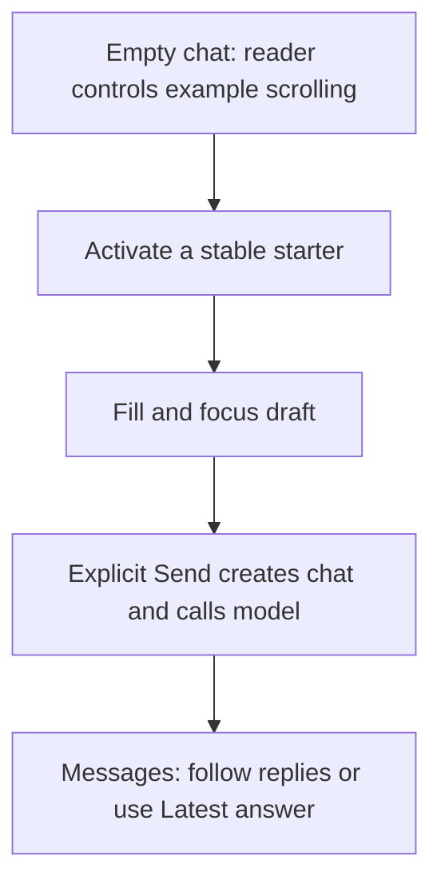

# Assistant starter repair — 2 Nov 2026

Owner approval: #331. Separate fix branch/PR from green main `6b4199f`, whose seven-job
CI 41445893500 passed before work. Cinema branch `feat/ab6-cinema-ingestion` at `0285b72`
and draft PR #125 are preserved. This repair starts no new sitting.

## Cause established before changing production code

The original local Chromium case failed for Mark, dark theme, 375×500. Playwright completed
the Unwatched 4Ks click, but the composer remained empty for the existing ten-second
assertion. The assistant page and original case matched main; that alone did not establish
the cause. Original trace preserved outside the test runner's replaceable output directory.

The empty landing shares the conversation's scrolling log. The follow-to-bottom effect
initially scrolled the examples down as availability resolved. Scrolling back to a starter
then set `away` and inserted **Latest answer**, despite there being no message or answer.
That control consumed 48px of flex height. At 375×500 the log shrank from 82.90625px to
34.90625px, clipping the already-measured starter centre at y=226.09375 below the new log
bottom at y=220. The button's own y did not change: its visible clipping area did.

A browser probe on the original production bundle captures that geometry, then clicks the
previously valid centre. Pointerdown/up/click all target the containing page, not the
starter; the composer remains empty. This reproduces the observed failure mechanism
without changing a timeout or relying on repeated probabilistic failures. A plain
instrumented click passed first; this is recorded as timing evidence, not a clearance.

Portable geometry/events and trace hashes: `assistant-starter-evidence-2026-11-02.json`.
Full original/probe traces remain in ignored `scratchpad/assistant-starter-fix/`.

## Behaviour and decisions

- Answer-following and Latest answer apply only while a transcript contains messages.
- Empty-page availability changes leave the reader's scroll position alone.
- Existing starter handlers, role guidance, drafts, explicit Send, recovery, model/caps and
  API/data contracts remain in place. No new storage, dependency, endpoint or layout size.
- The original browser assertions remain unchanged. The regression measures stable log
  height/target position during scrolling before one activation; both people/themes are
  covered at 375×500, with focus and zero new chats/model calls asserted.
- The existing streamed-answer test still proves that scrolling up preserves the reader's
  position while fragments arrive and Latest answer returns to the bottom.

## Verification and failures

Before repair, the new unit regression fails because scrolling the empty landing creates
Latest answer. The new browser regression fails with log client height 81 → 33px. The
controlled click probe fails with the same empty-draft assertion as the original case.
After repair, all 24 assistant page unit cases pass, including pending availability,
single starter activation/focus, draft retention and streamed-answer scrolling.

All seven targeted assistant browser cases pass in Chromium and Firefox. On clean
`7b67375f2966afd34c16aa440c0fa4019ada2a49`, all ten local gate commands pass: API 2,549
with zero skips, shared 159, web 737, lint/types/format/build. Full local E2E starts and
ends on that same commit: Chromium 62 pass, Firefox 61 pass plus its documented dictation
skip, jobs six pass. No retries or new skips. The Mac cannot run Playwright WebKit.

PR #126, exact-head CI 41512031733, passes all seven jobs including Chromium 62, Firefox
61 plus one documented skip, WebKit 60 plus its two documented skips, jobs six. Migration
reversal and image build/migrate/boot pass. PR #126 merged as `7b67375`; production API
and web both serve that exact commit, db is ok and all five integrations are configured.
The first deployment sample showed the old web SHA while the API had updated; 21 seconds
later both matched. No configuration/readiness error. Captures inspected for Mark at
375×500 in both themes show the filled, focused draft, reachable Send and no Latest answer.

Portable gate/CI/deployment evidence: `assistant-starter-verification-2026-11-02.json`.
Main code CI 41545752108 and the subsequent documentation head receive their own automatic
runs. Final exact-head CI/deployment close-out evidence is recorded in PR #126's description
before handoff; this code proof does not substitute for that final check.

Investigation tooling: the old Mac Git does not support `branch --show-current`; branch
inspection uses supported commands. An initial combined documentation patch did not match
and applied nothing; the corrected patch applied. The scratch diagnostic config initially
lacked its ESM package marker and failed before browser/API startup; adding a scratch-only
`type: module` marker fixed it. No app configuration or gate was altered for these repairs.

## Acceptance checklist

| Criterion | Evidence/status |
|---|---|
| Demonstrated cause; fails before/passes after | Probe and both regressions fail before; unit and browser regressions pass after |
| Single activation fills/focuses without chat/model call | Unit and both-browser/both-person/theme checks pass; no new chats/model calls |
| Existing roles/themes/viewports/drafts/recovery retained | Assertions retained; full local and three-browser PR CI suites pass |
| All ten gates, local browser/jobs, seven-job CI and production proof | Ten local checks/full suites/seven PR jobs pass; exact code API/web/readiness verified; final docs head checked separately |
| Scope boundaries | No provider/source/model/live-data/configuration/credential change; AB6 resumes only after final repair proof |

To observe after shipment: Assistant → scroll examples on a short screen → Unwatched 4Ks.
The question appears in the composer with focus; Send remains explicit. In a conversation
with messages, scrolling up still exposes Latest answer. Physical iPhone keyboard/speech
and live-model follow-up acceptance remain Craig's; browser emulation cannot close them.

AB6 fresh all-nine acceptance read, production configuration/import/enable and AB7 retain
their own checkpoints. AA10c and all other sittings remain excluded.
